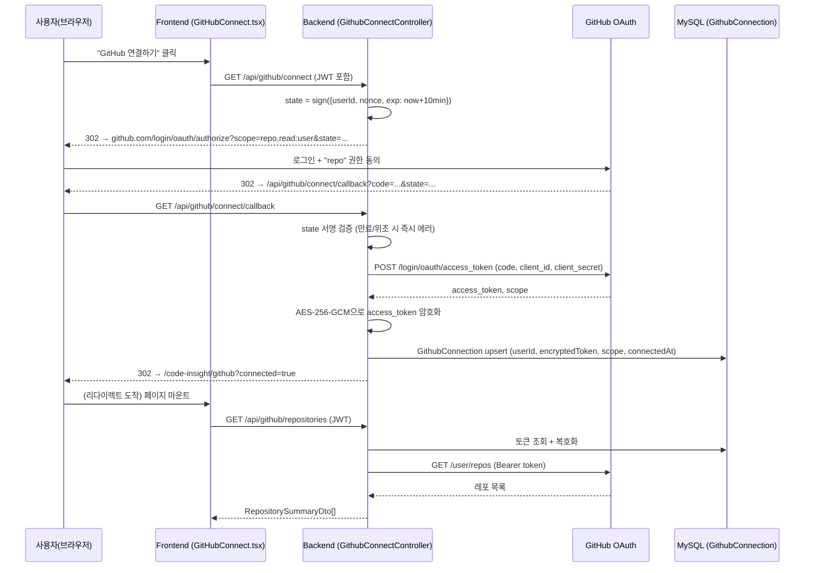
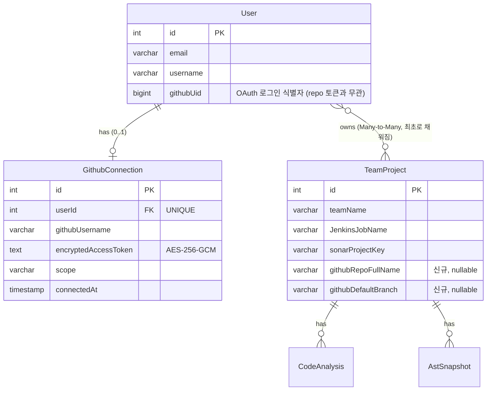
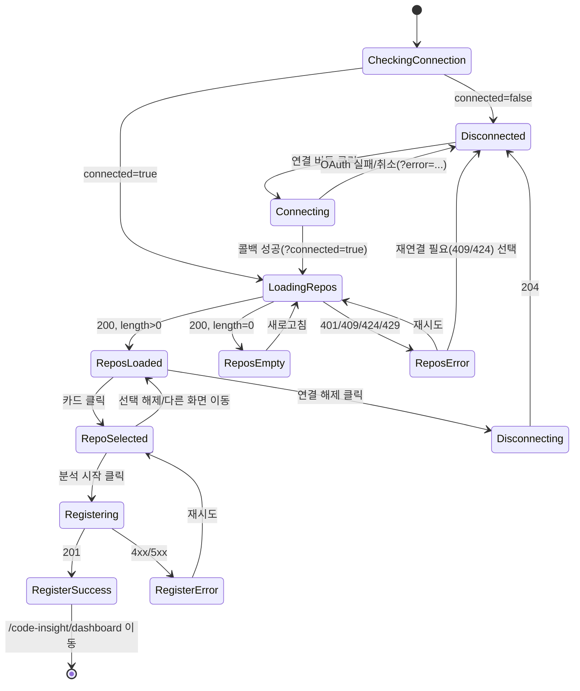

# Spec: 18_github_repository_integration (GitHub Repository 연동 — Project Analysis)

> 대상 프로젝트: RE:FACTORY (code-vi-internal) — `code-vi-internal/code-vi-back` (NestJS) + `code-vi-internal/code-vi-front` (React)
> 관련 화면: Code Insight → Project Analysis → GitHub 연동
---

## 0. 사실 확인 (현재 상태)

작성 전 실제 코드를 전수 확인한 결과다. 명세서의 모든 설계는 아래 사실을 근거로 한다.

### 0.1 프론트 — 더미 상태 (교체 대상)
- `code-vi-front/src/pages/CodeInsight/ProjectAnalysis/ProjectAnalysis.tsx` — "Project Analysis" 화면 실존. ZIP 업로드 카드 / GitHub 연동 카드 두 개로 분기.
- `code-vi-front/src/pages/CodeInsight/GitHubConnect/GitHubConnect.tsx` — **완전 더미**:
  - `dummyRepositories: Repo[]` 하드코딩 배열 4개.
  - `handleGitHubConnect`는 `setTimeout(1500)`으로 연결을 흉내만 냄. 실제 API 호출 없음.
  - `handleAnalyze`는 `navigate('/code-insight/dashboard')`만 호출 — 선택한 repo 정보를 백엔드에 전달하지 않음.
- 라우트는 `App.tsx`에 이미 등록됨: `/code-insight/project`, `/code-insight/github`, `/code-insight/dashboard`.

### 0.2 백엔드 — 이미 존재하는 것 (재사용 대상)
- **GitHub OAuth 로그인은 이미 동작 중** (`auth/auth.controller.ts` `GET /auth/github/signin`, `GET /auth/github/callback`, `auth/strategies/github.strategy.ts`).
  - `scope: ['user:email', 'read:user']`뿐 — **`repo` scope 없음**.
  - `validate()`가 `accessToken` 파라미터를 받지만 **어디에도 저장하지 않고 폐기**함. `findOrCreateGithubUser`엔 `githubUid/email/name`만 전달.
  - 콜백 성공 시 `res.redirect('${frontendUrl}/auth/github-callback?jwtToken=Bearer ${jwt}')` — 쿼리스트링으로 JWT 전달, 프론트가 `localStorage.accessToken`에 저장 (`services/api.ts` 인터셉터가 이 값을 `Authorization: Bearer` 헤더로 자동 주입).
  - `JwtStrategy`는 `ExtractJwtFromAuthHeaderAsBearerToken` — 쿠키 아님, 헤더 기반.
- `github-analysis/github/github.service.ts` — **PAT 기반**, OAuth와 무관한 별도 기능. `injectJenkinsfile(encryptedPat, repoUrl)`: RSA로 암호화된 PAT를 `authService.decryptText()`로 복호화 후 `new Octokit({ auth: pat })`으로 Jenkinsfile 존재 확인/생성.
- `github-analysis/onboarding/onboarding.service.ts::onboardUserProject(encryptedPat, repoUrl)` → `injectJenkinsfile` + `jenkinsService.createPipelineJob(jobName, repoUrl)` 호출. **레포 목록 조회 API는 어디에도 없음** — 지금 프로젝트에서 "GitHub 레포 목록 조회" 백엔드 기능은 0%.
- `auth/auth.service.ts::generateRsaKeyPair()` — **서버 프로세스 시작 시마다 새 RSA 키 쌍을 메모리에서 생성**(영속 저장 안 함). PAT 암호화는 "브라우저에서 암호화 → 같은 프로세스에서 즉시 복호화 후 폐기"하는 **1회성** 용도로만 설계됨. ⚠️ **서버 재시작 시 이전에 암호화된 값은 복호화 불가** — 장기 보관이 필요한 GitHub access token에는 이 방식을 재사용할 수 없음 ([6.2](#62-토큰-저장-방식) 근거).
- `team-project/entities/team-project.entity.ts` — 필드는 `teamName`, `JenkinsJobName`, `sonarProjectKey`뿐. **repository 관련 필드 전무**. `User.teamProjects` ManyToMany 관계가 엔티티에는 있으나, **어떤 코드에서도 이 join을 실제로 채우지 않음** — `team-project.service.ts::createJenkinsNotification`은 Jenkins가 빌드 완료 후 호출할 때만 `JenkinsJobName` 기준으로 `TeamProject`를 find-or-create할 뿐, 사용자 소유권 연결 로직이 없음.
- `common/api-response-dto/api-response.dto.ts` — 표준 응답 포맷 `{ success, statusCode, message, data?, meta? }`.
- `main.ts`에 `app.setGlobalPrefix('api')` — 모든 컨트롤러 경로 앞에 `/api` 자동 부착.
- 인증 가드 컨벤션: `@UseGuards(AuthGuard())` (기본 전략 = jwt) + `@GetUser() user: User` 데코레이터 (`auth/custom-guards-decorators/get-user.decorator.ts`) 로 현재 로그인 사용자 주입.
- `.env`에 `GITHUB_CLIENT_ID`, `GITHUB_CLIENT_SECRET`, `GITHUB_REDIRECT_URI=http://localhost:13000/api/auth/github/callback` 이미 설정되어 있고 로그인에 정상 사용 중 — **같은 OAuth App을 재사용하여 scope만 확장**하면 된다 (신규 App 생성 불필요).

### 0.3 결론 — 방식 선택
- 새 GitHub App을 또 만들면 로그인용 OAuth App과 레포 접근용 GitHub App이 공존하는 이중 구조가 되어 오히려 복잡도가 커진다.
- 따라서 본 명세서는 **기존 GitHub OAuth App의 scope를 `repo`까지 확장**하고, `GET /user/repos` (OAuth 표준 API)로 레포 목록을 조회하는 방식을 채택한다. GitHub App 전환은 [15장](#15-향후-확장)의 확장 옵션으로 남긴다.
- "코드 파일 조회"는 PDF가 제안한 "Contents API를 파일 단위로 재귀 호출"이 아니라, **레포 전체를 zipball로 1회 다운로드**한 뒤 기존 `zip-analysis` 파이프라인(`ZipAnalysisService.analyzeZipFile`, tree-sitter parser 프록시, 디렉터리 필터링 이미 구현됨)에 그대로 태우는 방식을 채택한다. 파일 수만큼 GitHub API를 호출하는 것보다 rate limit(5,000 req/hour) 소모가 훨씬 적고, 이미 검증된 필터링/정규화 로직을 재사용할 수 있다.

---

## 1. 기능 개요

**왜 필요한가**: Project Analysis 화면의 GitHub 연동 카드는 현재 더미 데이터만 보여주며 실제로 아무 것도 분석하지 않는다. 사용자가 로컬에 프로젝트를 내려받아 ZIP으로 압축하는 대신, GitHub 계정만 연결하면 보유한 레포지토리를 바로 선택해 분석/CI 등록까지 이어지도록 만드는 것이 목표다.

**사용자 흐름 요약**:
1. Project Analysis에서 "GitHub 연동" 카드 클릭
2. (최초 1회) GitHub 계정 연결 — 로그인과는 별개로 **레포 접근 권한**을 추가 동의
3. 연결된 GitHub 계정의 레포지토리 목록이 실시간으로 표시됨
4. 사용자가 분석할 레포지토리 선택
5. 선택한 레포가 "분석 대상 프로젝트"로 등록됨 (Jenkinsfile 자동 주입 + Jenkins Job 생성 — 기존 Onboarding 파이프라인 재사용)
6. Dashboard로 이동, 이후 커밋/빌드가 발생할 때마다 지표가 갱신됨

**로그인과의 구분**: 기존 `/auth/github/signin`은 "이 서비스에 로그인하기 위한" 신원 확인용이며 `repo` scope가 없다. 본 기능은 이미 로그인된 사용자가 **추가로** 레포 접근 권한을 부여하는 별도 플로우다(로그인 세션과 GitHub 레포 연결 상태는 독립적으로 존재할 수 있음 — 구글로 로그인한 사용자도 GitHub 레포 연동은 가능해야 함).

---

## 2. User Flow

```mermaid
flowchart TD
    A[Project Analysis 화면] --> B[GitHub 연동 카드 클릭]
    B --> C{GitHub 연결 상태<br/>GET /api/github/connection}
    C -- 미연결 --> D[GitHub 연결하기 버튼]
    D --> E[GET /api/github/connect 리다이렉트]
    E --> F[GitHub 로그인 및 권한 동의 화면<br/>scope: repo]
    F --> G[GET /api/github/connect/callback]
    G -- 인가 실패/취소 --> D
    G -- 성공 --> H[Access Token 암호화 저장]
    H --> I[프론트: /code-insight/github?connected=true 복귀]
    C -- 연결됨 --> I
    I --> J[GET /api/github/repositories 호출]
    J -- 실패 --> J1[에러 뷰 + 재시도 버튼]
    J -- 성공, 0건 --> J2[Empty State: 접근 가능한 레포 없음]
    J -- 성공, 1건 이상 --> K[레포지토리 목록 표시]
    K --> L[사용자가 레포 선택]
    L --> M[POST /api/github/projects]
    M -- 실패 --> M1[에러 안내 + 재시도]
    M -- 성공 --> N[Jenkinsfile 주입 + Jenkins Job 생성 + TeamProject 등록]
    N --> O[/code-insight/dashboard 이동]
```

---

## 3. 화면(UI) 변경사항

`GitHubConnect.tsx`(더미) → 실제 연동 화면으로 교체. 화면 자체 위치/카드 구조는 유지하되 내부 로직을 상태 기반으로 재작성한다.

### 3.1 추가/변경되는 UI 요소

| 요소 | 현재(더미) | 변경 후 |
|---|---|---|
| "GitHub으로 연결" 버튼 | `setTimeout` 시뮬레이션 | `window.location.href`로 `/api/github/connect`(GET) 이동 |
| 레포지토리 목록 | `dummyRepositories` 4개 고정 | `GET /api/github/repositories` 응답 렌더링 (실시간) |
| "분석 시작" 버튼 | `navigate('/code-insight/dashboard')`만 호출 | `POST /api/github/projects` 호출 → 성공 시 이동 |
| 연결 상태 뱃지 | 없음 | 헤더 우측에 "GitHub: 연결됨(@아이디)" / "연결 안 됨" 표시 |
| Reconnect | 없음 | 연결됨 상태에서 "다시 연결" 버튼 → `/api/github/connect` 재호출(스코프 재동의) |
| Disconnect | 없음 | "연결 해제" 버튼 → `DELETE /api/github/connection` 확인 모달 후 호출 |
| Refresh | 없음 | 레포 목록 우측 "새로고침" 아이콘 버튼 → `GET /api/github/repositories` 재호출 |

### 3.2 상태별 UI 정의

| 상태 | 트리거 | 표시 내용 |
|---|---|---|
| `disconnected` | 최초 진입, 연결 정보 없음 | GitHub 로고 + "GitHub 계정 연결" 카드 (기존 디자인 유지) |
| `connecting` | 연결 버튼 클릭 직후 ~ 콜백 복귀 전 | 버튼에 스피너 + "연결 중..." (기존 `isConnecting` 패턴 유지, 단 실제로는 풀 페이지 리다이렉트라 이 상태는 클릭~리다이렉트 사이 찰나만 보임) |
| `connect_error` | 콜백에서 `?error=github_connect_failed` 등 쿼리 수신 | "GitHub 연결에 실패했습니다" + 재시도 버튼 |
| `loading_repos` | 연결 성공 직후 / Refresh 클릭 | 레포 목록 영역에 스켈레톤 3~4개 |
| `repos_error` | `GET /api/github/repositories` 실패(토큰 만료 등) | "레포지토리를 불러오지 못했습니다" + 재시도 + (401이면) 재연결 유도 |
| `repos_empty` | 응답 배열 length 0 | "접근 가능한 레포지토리가 없습니다. GitHub에서 저장소 접근 권한을 확인하세요" |
| `repos_loaded` | 정상 응답 | 레포 카드 리스트 (언어 색상 dot, 업데이트일 등 기존 UI 유지, private 배지 추가) |
| `repo_selected` | 카드 클릭 | 선택 카드 하이라이트 + 하단 "{repo} 분석 시작" 버튼 활성화 |
| `registering` | 분석 시작 클릭 | 버튼 비활성 + "프로젝트 등록 중..." (Jenkins Job 생성은 수 초 소요될 수 있음) |
| `register_error` | `POST /api/github/projects` 실패 | 에러 메시지(권한 부족/이미 등록됨 등 구분) + 재시도 |
| `register_success` | 등록 성공 | `/code-insight/dashboard`로 이동 (기존 흐름 유지) |

---

## 4. Frontend 설계

### 4.1 컴포넌트 구조

기존 폴더당 `Component.tsx` + `Component.css` + `index.ts` 컨벤션을 유지한다.

```
pages/CodeInsight/GitHubConnect/
├── GitHubConnect.tsx           # 컨테이너 — 상태 머신 + API 호출 오케스트레이션 (기존 파일 교체)
├── GitHubConnect.css           # 기존 스타일 유지 + 신규 상태 스타일 추가
├── components/
│   ├── RepositoryList.tsx      # 레포 목록 렌더 (로딩/에러/빈 상태 분기)
│   ├── RepositoryCard.tsx      # 레포 1개 카드 (이름/설명/언어/private뱃지/업데이트일)
│   ├── ConnectionBadge.tsx     # 상단 연결 상태 뱃지 + Reconnect/Disconnect 버튼
│   └── EmptyState.tsx          # 레포 없음 / 에러 공용 안내 컴포넌트 (아이콘 + 메시지 + 액션 버튼 props)
└── index.ts
```

- `LoadingSpinner`, `ErrorView`는 이미 다른 화면(`OnboardingPage` 등)에 유사 패턴이 있는지 확인 후, 없다면 `components/common/`에 공용으로 신설(다른 페이지도 재사용 가능하도록). 없으면 `GitHubConnect` 로컬에만 두고 과도한 공용화는 지양한다.

### 4.2 State 관리

Redux/Zustand 등 전역 상태 라이브러리는 프로젝트 전체에 없음(로컬 `useState`만 사용) — 이 컨벤션을 따른다.

`GitHubConnect.tsx` 내부 상태:

| State | 타입 | 설명 |
|---|---|---|
| `phase` | `'disconnected' \| 'connecting' \| 'connect_error' \| 'loading_repos' \| 'repos_error' \| 'repos_empty' \| 'repos_loaded'` | [3.2](#32-상태별-ui-정의)의 상태 머신 |
| `githubUsername` | `string \| null` | 연결된 GitHub 계정명 (뱃지 표시용) |
| `repositories` | `Repo[]` | 목록 |
| `selectedRepo` | `Repo \| null` | 선택된 레포 |
| `registerPhase` | `'idle' \| 'registering' \| 'error'` | 등록 버튼 별도 상태 |

`useEffect`로 마운트 시 `GET /api/github/connection` 호출 → 연결 여부 판별 → 연결돼 있으면 즉시 `loading_repos`로 전환 후 목록 조회(기존 `handleGitHubConnect`의 setTimeout 로직 제거).

### 4.3 Service 계층

`src/services/githubConnectService.ts` 신설 (기존 `onboardingService.ts` 패턴 그대로 따름 — `res.data?.data ?? res.data`로 `ApiResponseDto` 언래핑):

| 함수 | 메서드/경로 | 반환 |
|---|---|---|
| `getConnectionStatus()` | `GET /api/github/connection` | `{ connected: boolean; githubUsername?: string }` |
| `redirectToConnect()` | `window.location.href = '/api/github/connect'` | void (풀 리다이렉트, `authService.redirectToGithubSignIn` 패턴과 동일) |
| `listRepositories()` | `GET /api/github/repositories` | `RepositorySummary[]` |
| `registerProject(owner, repo)` | `POST /api/github/projects` | `{ teamProjectId: number; jenkinsJobName: string }` |
| `disconnect()` | `DELETE /api/github/connection` | void |

`api.ts`의 axios 인스턴스(자동 JWT 헤더 주입, 401 리다이렉트)를 그대로 사용 — 별도 인증 처리 불필요.

### 4.4 콜백 라우트

기존 `/auth/github-callback`(로그인용, `pages/GithubCallback/GithubCallback.tsx`)과는 **다른 콜백**이 필요하다 — 로그인 콜백은 JWT를 받아 로그인 세션을 여는 용도이고, 이번 콜백은 "레포 연결이 끝났다"는 결과만 프론트에 알리면 된다.

- 신규 라우트 불필요: 백엔드 콜백(`GET /api/github/connect/callback`)이 처리를 마친 뒤 곧바로 `/code-insight/github?connected=true` (또는 `?error=...`)로 302 리다이렉트한다. `GitHubConnect.tsx`가 마운트 시 쿼리스트링을 읽어 `connect_error` 상태를 판별한다. (별도 `GithubConnectCallback.tsx` 페이지를 만들지 않아 라우트 수 증가를 최소화 — YAGNI)

---

## 5. Backend 설계

### 5.1 신규 모듈 `github-connect` (기존 `github-analysis`와 별도 모듈로 분리)

`github-analysis`(PAT+Jenkinsfile 주입)와 개념이 다르므로 혼동을 피하기 위해 새 모듈로 분리하되, 실제 Jenkinsfile 주입/Job 생성 로직은 **재사용**한다.

```
src/github-connect/
├── github-connect.module.ts       # imports: AuthModule, UsersModule, GithubModule(github-analysis), JenkinsModule, TeamProjectModule
├── github-connect.controller.ts   # @Controller('github')
├── github-connect.service.ts      # OAuth state 서명/검증, 토큰 교환, 암복호화, GET /user/repos 프록시
├── entities/
│   └── github-connection.entity.ts
├── dto/
│   ├── repository-summary.dto.ts
│   └── register-project-request.dto.ts
└── guards/
    └── github-oauth-state.guard.ts   # (필요 시) state 파라미터 서명 검증 유틸
```

### 5.2 Controller — 엔드포인트

| Method | Path | Guard | 설명 |
|---|---|---|---|
| GET | `/api/github/connect` | `AuthGuard()` | 현재 로그인 사용자 id를 HMAC 서명한 `state`와 함께 GitHub OAuth 인가 URL로 302 리다이렉트 |
| GET | `/api/github/connect/callback` | 없음(GitHub이 호출) | `code`+`state` 검증 → access token 교환 → 암호화 저장 → 프론트로 302 리다이렉트 |
| GET | `/api/github/connection` | `AuthGuard()` | 현재 사용자의 연결 상태 조회 |
| GET | `/api/github/repositories` | `AuthGuard()` | 저장된 토큰으로 `GET /user/repos` 프록시, 정규화하여 반환 |
| POST | `/api/github/projects` | `AuthGuard()` | 선택 레포를 분석 대상으로 등록 (Jenkinsfile 주입 + Job 생성 + TeamProject upsert) |
| DELETE | `/api/github/connection` | `AuthGuard()` | 연결 해제 (토큰 삭제 + GitHub grant revoke) |

### 5.3 Service 책임 분리

| 메서드 | 위치 | 책임 |
|---|---|---|
| `buildAuthorizeUrl(userId)` | `GithubConnectService` | `state = sign({ userId, nonce, exp })`; `https://github.com/login/oauth/authorize?client_id=...&scope=repo,read:user&state=...&redirect_uri=.../api/github/connect/callback` 조립 |
| `handleCallback(code, state)` | `GithubConnectService` | `state` 서명 검증(위조/재사용 방지) → `POST https://github.com/login/oauth/access_token`으로 code 교환 → `GithubConnection` upsert(암호화 저장) |
| `getConnection(userId)` | `GithubConnectService` | 연결 존재 여부 + `githubUsername` 캐시값 반환 |
| `listRepositories(userId)` | `GithubConnectService` | 토큰 복호화 → `Octokit({ auth: token }).repos.listForAuthenticatedUser({ per_page: 100, sort: 'updated' })` (페이지네이션 처리) → `RepositorySummaryDto[]`로 매핑 |
| `registerProject(userId, owner, repo)` | `GithubConnectService` | 토큰 복호화 → **기존** `GithubModule.GithubService.injectJenkinsfile(token, repoUrl)` 호출(시그니처를 "암호화된 PAT" 대신 "평문 토큰"을 받도록 소폭 조정 필요 — [8.3](#83-기존-모듈-수정-필요-사항) 참고) → **기존** `JenkinsService.createPipelineJob(jobName, repoUrl)` → `TeamProject` upsert + `User.teamProjects` 관계 최초로 채움 |
| `revokeConnection(userId)` | `GithubConnectService` | `DELETE https://api.github.com/applications/{client_id}/grant` (Basic auth: client_id/secret, body에 access_token) 호출 후 `GithubConnection` row 삭제 |

### 5.4 DTO

`RepositorySummaryDto`:

| 필드 | 타입 | 설명 |
|---|---|---|
| `id` | number | GitHub repo id |
| `name` | string | 레포 이름 |
| `fullName` | string | `owner/repo` |
| `private` | boolean | 비공개 여부 |
| `description` | string \| null | 설명 |
| `language` | string \| null | 대표 언어 |
| `defaultBranch` | string | 기본 브랜치 |
| `updatedAt` | string (ISO) | 마지막 푸시 시각 |
| `htmlUrl` | string | GitHub 웹 URL |

`RegisterProjectRequestDto`:

| 필드 | 타입 | 필수 | 설명 |
|---|---|---|---|
| `owner` | string | Y | 레포 소유자 |
| `repo` | string | Y | 레포 이름 |
| `teamName` | string | N | 미지정 시 `owner/repo`로 기본값 |

---

## 6. GitHub OAuth Flow

### 6.1 Authorization Code Flow (Sequence Diagram)



### 6.2 토큰 저장 방식

- **저장 위치**: 신규 엔티티 `GithubConnection` (User와 1:1). DB에 저장(세션/인메모리 아님) — 서버 재시작 후에도 재연결 없이 동작해야 하므로.
- **암호화 방식**: **AES-256-GCM 대칭키**. 이유: 기존 `AuthService`의 RSA 키 쌍은 프로세스 시작마다 재생성되고 영속화되지 않아([0.2](#02-백엔드--이미-존재하는-것-재사용-대상) 참고) 장기 보관에 부적합함이 코드로 확인됨. 신규 환경변수 `GITHUB_TOKEN_ENC_KEY`(32byte, base64)를 도입하고 `.env`에 추가한다. IV는 매 암호화마다 랜덤 생성해 ciphertext 앞에 붙여 저장.
- **Refresh 여부**: GitHub OAuth App의 기본 access token은 **만료가 없다**(GitHub Apps와 달리 OAuth App 토큰은 무기한, 단 사용자가 직접 revoke하거나 90일 미사용 시 GitHub가 자동 만료시킬 수 있음). 별도 refresh token 플로우는 구현하지 않되, `GET /api/github/repositories` 호출 시 GitHub가 `401`을 반환하면 `GithubConnection`을 무효 처리하고 프론트에 재연결을 요구한다([11장](#11-예외-처리) 참고).
- **Session/JWT 처리**: 레포 연결 자체는 세션을 만들지 않는다 — 기존 로그인 JWT(`AuthGuard()`)로 사용자를 식별하고, `GithubConnection`은 그 JWT의 `userId`에 매핑된 부가 데이터일 뿐이다.
- **로그아웃**: 서비스 로그아웃(`authService.logout`)은 `localStorage.accessToken`만 지운다 — `GithubConnection`은 삭제하지 않는다(재로그인 시 레포 연결이 유지되어야 함). 로그아웃과 GitHub 연결 해제는 별개 동작이다.
- **재연동(Reconnect)**: `GET /api/github/connect`를 다시 호출하면 GitHub는 이미 동의한 스코프에 대해 재동의 화면을 생략하고 바로 code를 발급할 수 있다(GitHub 정책) — `handleCallback`은 기존 row가 있으면 token을 덮어쓰는 upsert로 처리한다.
- **토큰 만료**: [6.2](#62-토큰-저장-방식) 상단 참고 — GitHub 응답 401을 유일한 신호로 삼는다(OAuth App은 별도 만료 API가 없음).

### 6.3 CSRF / State 검증

- `state` 파라미터는 `{ userId, nonce, exp }`를 서버 비밀키(JWT_SECRET 재사용 가능하나, 별도 `GITHUB_OAUTH_STATE_SECRET` 권장)로 서명한 값. 콜백에서 서명 불일치·만료(10분) 시 즉시 `400`으로 거부하고 프론트를 `?error=invalid_state`로 리다이렉트.
- **PKCE**: OAuth App(Confidential Client, 서버가 client_secret을 보유)이므로 PKCE는 필수가 아니다 — client_secret 자체가 이미 기밀 유지 요건을 충족한다. (GitHub App이나 SPA 단독 구현으로 전환할 경우에만 PKCE 재검토)

---

## 7. GitHub API 명세

| API | 용도 | 인증 헤더 |
|---|---|---|
| `POST https://github.com/login/oauth/access_token` | authorization code → access token 교환 | `Accept: application/json` (body: client_id, client_secret, code) |
| `GET https://api.github.com/user` | (선택) 연결된 GitHub 계정명 확인용 | `Authorization: Bearer {token}` |
| `GET https://api.github.com/user/repos` | 사용자 레포 목록 (List repositories for the authenticated user) | `Authorization: Bearer {token}`, `Accept: application/vnd.github+json` |
| `GET https://codeload.github.com/{owner}/{repo}/zip/{ref}` 또는 `GET /repos/{owner}/{repo}/zipball/{ref}` | 선택 레포 소스 전체 다운로드 (분석 파이프라인 투입용, [0.3](#03-결론--방식-선택) 근거) | `Authorization: Bearer {token}` |
| `DELETE https://api.github.com/applications/{client_id}/grant` | 연결 해제 시 GitHub 측 토큰 폐기 | `Authorization: Basic base64(client_id:client_secret)`, body: `{ access_token }` |

### Response 예시 — `GET /api/github/repositories`

```json
{
  "success": true,
  "statusCode": 200,
  "message": "OK",
  "data": [
    {
      "id": 123456,
      "name": "CodeVi",
      "fullName": "rlawogh1005/CodeVi",
      "private": false,
      "description": "Requirements & code quality platform",
      "language": "TypeScript",
      "defaultBranch": "master",
      "updatedAt": "2026-07-18T09:12:00Z",
      "htmlUrl": "https://github.com/rlawogh1005/CodeVi"
    }
  ]
}
```

### Rate Limit 고려사항

- OAuth App 토큰의 기본 rate limit은 **5,000 requests/hour** (사용자 기준).
- `GET /user/repos`는 `per_page=100`으로 페이지네이션해 호출 수를 최소화한다.
- zipball 다운로드는 레포당 1회 호출이므로 rate limit에 미치는 영향이 매우 작다 (PDF가 제안한 파일 단위 Contents API 재귀 호출 대비 수십~수백 배 적은 호출 수).
- 향후 여러 사용자가 몰릴 경우를 대비해 `listRepositories` 결과를 사용자별로 30초~1분 정도 짧게 인메모리 캐시하는 것을 고려할 수 있음(본 스펙 범위에서는 필수 아님, [15장](#15-향후-확장)).

---

## 8. Database 변경사항

### 8.1 신규 엔티티 `GithubConnection`

| 필드 | 타입 | 제약 | 설명 |
|---|---|---|---|
| `id` | int (PK, autoincrement) | `CommonEntity` 상속 | |
| `createdAt` / `updatedAt` | timestamp | `CommonEntity` 상속 | |
| `userId` | int | FK → `User.id`, **UNIQUE** | 사용자당 GitHub 연결은 1개 |
| `githubUsername` | varchar | nullable | 뱃지 표시용 캐시(`GET /user` 1회 조회 결과) |
| `encryptedAccessToken` | text | not null | AES-256-GCM 암호문(IV 포함, base64) |
| `scope` | varchar | not null | 예: `"repo,read:user"` — 재연결 시 스코프 변경 감지용 |
| `connectedAt` | timestamp | not null | 최초 연결 시각 |

```prisma
// (참고용 표기 — 실제 구현은 TypeORM @Entity 데코레이터로 작성)
```

### 8.2 `TeamProject` 엔티티 컬럼 추가

| 필드 | 타입 | 제약 | 설명 |
|---|---|---|---|
| `githubRepoFullName` | varchar | nullable | `owner/repo` — GitHub 경유로 등록된 프로젝트만 값 존재 |
| `githubDefaultBranch` | varchar | nullable, default `'main'` | 분석/Jenkins 빌드 기준 브랜치 |

### 8.3 기존 모듈 수정 필요 사항

- `GithubModule.GithubService.injectJenkinsfile(encryptedPat, repoUrl)`: 현재 시그니처는 "RSA 암호화된 PAT"를 받아 내부에서 `authService.decryptText()`로 복호화한다. OAuth 플로우에서는 이미 평문 토큰을 들고 있으므로, **암호화 여부를 호출부에서 결정할 수 있도록** 오버로드하거나 `injectJenkinsfileWithToken(plainToken, repoUrl)` 형태의 별도 진입점을 추가한다(기존 PAT onboarding 경로는 그대로 유지). 새 코드를 작성하지 않는 본 문서의 범위에서는 "이 시그니처 조정이 필요하다"는 사실만 명시한다.
- `TeamProjectService`: `User.teamProjects` 조인을 채우는 코드가 지금 어디에도 없음 — `GithubConnectService.registerProject()`가 **최초로** 이 관계를 채우는 지점이 된다. TeamProject를 찾거나 생성한 뒤 `manager.save(TeamProject, { ...project, users: [...(project.users||[]), user] })` 형태로 upsert해야 한다(id 재저장 시 users 배열 유실 방지 주의).

### 8.4 ERD (추가분 반영)



> 기존 `code-vi-internal/code-vi-front/docs/erd.md`는 이미 실제 엔티티와 어긋난 부분이 있으므로(User에 teamName 등 잘못 표기), 본 기능 구현 시 해당 문서도 함께 현행화할 것을 권장한다([14장 체크리스트](#14-체크리스트) 포함).

---

## 9. API 명세

모든 응답은 `ApiResponseDto` 포맷(`{ success, statusCode, message, data?, meta? }`)을 따른다.

### `GET /api/github/connect`
- **인증**: JWT 필요
- **응답**: 302 리다이렉트 (본문 없음)

### `GET /api/github/connect/callback`
- **Query**: `code`, `state`
- **응답**: 302 리다이렉트 → `/code-insight/github?connected=true` 또는 `?error={code}`
- **에러 리다이렉트 코드**: `invalid_state`(400 상당), `github_token_exchange_failed`(502 상당), `email_missing`(해당 없음 — 로그인 시에만 이메일 필요, 본 플로우는 이메일 불요)

### `GET /api/github/connection`
- **인증**: JWT
- **200 응답**:
```json
{ "success": true, "statusCode": 200, "message": "OK", "data": { "connected": true, "githubUsername": "rlawogh1005" } }
```
- 미연결 시 `data.connected: false`, `githubUsername: null` (에러 아님, 200)

### `GET /api/github/repositories`
| 상태 코드 | 상황 |
|---|---|
| 200 | 정상 (빈 배열 포함) |
| 401 | JWT 없음/만료 (전역 가드 처리) |
| 409 | `GithubConnection` 없음 — `"message": "GitHub 계정이 연결되어 있지 않습니다"` |
| 424 (Failed Dependency) | GitHub API 자체 실패(토큰 revoke됨 등) — `"message": "GitHub 인증이 만료되었습니다. 다시 연결해주세요"` |
| 429 | GitHub rate limit 초과 전달 |

### `POST /api/github/projects`
**Request**:
```json
{ "owner": "rlawogh1005", "repo": "CodeVi" }
```
| 상태 코드 | 상황 |
|---|---|
| 201 | 등록 성공 |
| 400 | `owner`/`repo` 누락 |
| 403 | 선택한 레포에 대한 접근 권한 없음(토큰 scope 부족 또는 private repo 미승인) |
| 404 | GitHub에서 해당 레포를 찾을 수 없음(삭제/이름 변경) |
| 409 | 이미 동일 `githubRepoFullName`으로 등록된 `TeamProject` 존재 — 신규 생성 대신 기존 프로젝트 정보 반환 |
| 500 | Jenkinsfile 주입/Job 생성 실패 |

**201 응답 예시**:
```json
{
  "success": true,
  "statusCode": 201,
  "message": "프로젝트가 등록되었습니다.",
  "data": {
    "teamProjectId": 42,
    "jenkinsJobName": "rlawogh1005-codevi",
    "githubRepoFullName": "rlawogh1005/CodeVi"
  }
}
```

### `DELETE /api/github/connection`
| 상태 코드 | 상황 |
|---|---|
| 204 | 해제 성공 |
| 409 | 애초에 연결돼 있지 않음 |
| 502 | GitHub grant revoke API 실패(로그만 남기고 로컬 row는 삭제 진행 — 사용자 경험상 "연결 안 됨" 상태가 우선) |

---

## 10. 상태 관리(State) — Frontend State Diagram



---

## 11. 예외 처리

| 상황 | 처리 방식 |
|---|---|
| OAuth 실패(GitHub 측 에러 콜백) | `?error=github_denied`로 리다이렉트 → "GitHub 인증이 취소되었습니다" 안내 |
| GitHub 로그인 화면에서 사용자가 취소 | 위와 동일 코드로 수렴 (GitHub가 `error=access_denied` 콜백을 보냄) |
| `state` 검증 실패(위조/만료) | 400 상당 → `?error=invalid_state`, 즉시 연결 버튼 재노출 |
| Access token 만료/revoke됨 | `GET /api/github/repositories` 424 반환 → 프론트가 "재연결이 필요합니다" 안내와 함께 `Disconnected` 상태로 강제 전환 |
| 레포지토리 없음 | `ReposEmpty` 상태, "레포지토리가 없습니다" + GitHub 저장소 접근 설정 링크 안내 |
| Private repository | `repo` scope로 이미 private 목록 조회 포함(OAuth App은 scope만 있으면 별도 승인 불요, GitHub App의 "레포 선택 설치"와의 핵심 차이). 단 Organization 소유의 private repo는 조직 정책(Third-party access restriction)에 따라 조직 관리자가 OAuth App을 승인해야 목록에 노출될 수 있음 — 이 경우 GitHub가 알아서 목록에서 제외하므로 백엔드가 별도 처리할 필요 없음, 프론트 안내 문구에만 "조직 저장소가 안 보이면 조직 관리자 승인이 필요할 수 있습니다" 추가 |
| Network Error(백엔드 자체 다운 등) | axios 인터셉터가 원본 에러 그대로 통과 → 화면에서 공통 `ErrorView` "네트워크 오류, 잠시 후 다시 시도해주세요" |
| Rate Limit(429) | GitHub 응답의 `X-RateLimit-Reset` 헤더를 그대로 우리 API의 `Retry-After`로 변환해 전달, 프론트는 "잠시 후 다시 시도해주세요" 안내 |
| 권한 부족(선택 레포가 scope 밖) | 403 → "선택한 저장소에 접근할 수 없습니다. GitHub에서 접근 권한을 확인해주세요" |
| 이미 등록된 프로젝트 재등록 시도 | 409 → 기존 `teamProjectId` 반환하고 프론트는 confirm 없이 바로 해당 프로젝트 대시보드로 이동(중복 Job 생성 방지) |

---

## 12. 보안

- **Access Token을 프론트 LocalStorage에 절대 저장하지 않는다.** JWT(`accessToken`)만 LocalStorage에 있고, GitHub access token은 항상 백엔드 DB에만 암호화 저장 — 어떤 API 응답에도 raw token을 포함시키지 않는다(`GET /api/github/connection`은 `githubUsername`만 노출).
- **HttpOnly Cookie 여부**: 기존 프로젝트가 JWT를 헤더 기반(LocalStorage)으로 이미 운용 중이므로 본 기능만 쿠키 방식으로 바꾸지 않는다(일관성 유지). GitHub access token 자체는 애초에 브라우저로 내려가지 않으므로 쿠키/로컬스토리지 논쟁과 무관하다.
- **Backend 저장 여부**: 저장한다(DB, `GithubConnection.encryptedAccessToken`).
- **암호화**: AES-256-GCM, 키는 `GITHUB_TOKEN_ENC_KEY` 환경변수(코드/레포에 커밋 금지, 기존 `.env`가 이미 `.gitignore` 대상인지 확인 — [8.3](#83-기존-모듈-수정-필요-사항)과 별개로 운영 배포 시 Secret Manager 사용 권장).
- **CSRF / OAuth State 검증**: [6.3](#63-csrf--state-검증) 참고 — state 서명 + 만료(10분) + 1회성(사용 후 즉시 무효화 권장, replay 방지).
- **PKCE**: 미적용(사유: Confidential Client, [6.3](#63-csrf--state-검증) 참고).
- **환경변수 신규 추가**:

| 변수 | 설명 |
|---|---|
| `GITHUB_TOKEN_ENC_KEY` | GitHub access token 저장용 AES-256 키 (32byte, base64 인코딩) |
| `GITHUB_OAUTH_STATE_SECRET` | OAuth `state` 서명용 비밀키 (`JWT_SECRET`과 분리 권장 — 용도 분리 원칙) |
| `GITHUB_CONNECT_REDIRECT_URI` | `{API_BASE}/api/github/connect/callback` — 기존 `GITHUB_REDIRECT_URI`(로그인용)과 별도로 GitHub OAuth App 설정에 **Authorization callback URL을 복수 등록**해야 함(GitHub OAuth App은 콜백 URL을 여러 개 등록 가능) |

- **GitHub OAuth App 설정 변경**: 기존 App의 "Authorization callback URL"에 로그인 콜백(`/api/auth/github/callback`) 외에 신규 콜백(`/api/github/connect/callback`)을 추가 등록해야 한다.
- **최소 권한 원칙**: 로그인 플로우는 여전히 `user:email read:user`만 사용(변경 없음). `repo` scope는 오직 신규 연결 플로우에서만 요청 — 로그인만 하고 레포 연동을 원치 않는 사용자에게 불필요한 권한 동의를 강요하지 않는다.

---

## 13. 구현 순서

### Phase 1 — Backend OAuth (repo scope 확장)
- [ ] `github-connect` 모듈 스캐폴딩 (module/controller/service)
- [ ] `GithubConnection` 엔티티 + TypeORM 마이그레이션(synchronize 설정 확인 — 기존 프로젝트가 auto-sync인지 migration 파일 방식인지 확인 후 동일하게)
- [ ] `GET /api/github/connect`, `GET /api/github/connect/callback` 구현 (state 서명/검증, access token 교환/암호화 저장)
- [ ] `.env`/`.env.local.example`에 신규 변수 추가, GitHub OAuth App에 콜백 URL 추가 등록

### Phase 2 — Repository API
- [ ] `GET /api/github/connection`, `GET /api/github/repositories` 구현
- [ ] `@octokit/rest` (이미 의존성에 존재) 재사용, `repos.listForAuthenticatedUser` 페이지네이션 처리
- [ ] 401/424/409/429 케이스별 응답 매핑

### Phase 3 — Frontend 연결
- [ ] `githubConnectService.ts` 신설
- [ ] `GitHubConnect.tsx`를 상태 머신 기반으로 재작성 (더미 데이터/`setTimeout` 제거)
- [ ] `RepositoryList`/`RepositoryCard`/`ConnectionBadge`/`EmptyState` 컴포넌트 분리

### Phase 4 — Repository 선택 및 등록
- [ ] `TeamProject`에 `githubRepoFullName`/`githubDefaultBranch` 컬럼 추가
- [ ] `POST /api/github/projects` 구현 — 기존 `GithubService.injectJenkinsfile`/`JenkinsService.createPipelineJob` 재사용(시그니처 조정), `TeamProject` upsert + `User.teamProjects` 관계 최초 population
- [ ] 409(중복 등록) 처리

### Phase 5 — Project Analysis 연결 및 마무리
- [ ] `GitHubConnect.tsx` "분석 시작" → 등록 성공 시 `/code-insight/dashboard` 이동 (기존 라우트 그대로 사용)
- [ ] `DELETE /api/github/connection` (연결 해제) 구현 및 UI 연결
- [ ] `code-vi-front/docs/erd.md` 현행화

---

## 14. 체크리스트

개발 완료 후 아래 항목을 모두 검증한다.

- [ ] 로그인만 한 사용자가 Project Analysis → GitHub 연동에 진입해도 기존 로그인 세션에 영향이 없다
- [ ] "GitHub 연결하기" 클릭 시 실제 GitHub 인가 화면(scope: repo)으로 이동한다
- [ ] 인가 동의 후 정상적으로 콜백 처리되어 레포 목록이 실시간으로 표시된다 (더미 4개가 아님)
- [ ] private repository도 목록에 정상 노출된다
- [ ] 레포가 0개인 GitHub 계정으로 테스트 시 Empty State가 표시된다
- [ ] 레포 선택 → 분석 시작 시 실제 대상 GitHub 레포에 Jenkinsfile이 생성/확인된다
- [ ] Jenkins Job이 실제로 생성된다 (`JenkinsJobName` 규칙 일치)
- [ ] `TeamProject`가 생성/조회되고 `User.teamProjects`에 현재 사용자가 연결된다
- [ ] 동일 레포를 두 번 등록 시 중복 `TeamProject`가 생기지 않는다(409 처리 확인)
- [ ] "연결 해제" 클릭 시 GitHub 계정 설정(Applications)에서도 authorization이 revoke된다
- [ ] 서버 재시작 후에도 기존에 저장된 GitHub 연결이 (토큰 만료 전까지) 정상 동작한다 — RSA 방식이 아닌 AES 방식임을 재확인
- [ ] Access token이 어떤 API 응답/브라우저 저장소에도 평문으로 노출되지 않는다 (네트워크 탭 확인)
- [ ] GitHub 계정 연결 없이 `GET /api/github/repositories` 호출 시 409, 명확한 에러 메시지 반환
- [ ] rate limit(429) 상황을 인위적으로 재현해 프론트 안내 문구 확인
- [ ] `docs/specs`(본 문서) 및 `code-vi-front/docs/erd.md` 최신화 여부

---

## 15. 향후 확장

- **GitHub App으로 전환**: 조직 단위로 "레포 선택 설치" UX가 필요해지면(현재 OAuth App은 전체 레포 접근 후 우리 쪽에서 선택하는 방식) 참고 PDF의 GitHub App(installation) 방식으로 전환 고려. 이 경우 `GithubConnection`을 `installation_id` 기반으로 재설계해야 함.
- **Organization Repository**: 현재 `GET /user/repos`는 사용자 개인 소유 + 접근 가능한 레포를 포함하지만, `GET /user/orgs` + `GET /orgs/{org}/repos` 조합으로 조직 레포를 별도 탭으로 분리해 보여주는 것도 가능.
- **Branch 선택**: `TeamProject.githubDefaultBranch`를 등록 시 기본값으로만 쓰지 말고, 등록 후에도 사용자가 분석 대상 브랜치를 바꿀 수 있는 UI 추가.
- **Commit 조회**: 대시보드에서 최근 커밋 목록/작성자를 함께 보여주는 위젯 (`GET /repos/{owner}/{repo}/commits`).
- **Webhook 연동**: 현재는 Jenkins가 폴링/수동 트리거 기반일 가능성이 높음(확인 필요) — GitHub push webhook → Jenkins 트리거 자동화로 "커밋 시 자동 재분석" 구현.
- **Clone 대신 zipball 스트리밍**: 대형 레포(수백 MB) 대응을 위해 전체 다운로드 대신 `git archive` 스트리밍이나 shallow clone 방식 검토.
- **Repository 분석 자동 실행**: 현재는 등록 즉시 최초 1회 분석이 자동 트리거되는지 Jenkins Job 설정에 달려 있음 — 등록 API 응답에 "최초 빌드 트리거 완료" 여부를 명시적으로 포함하는 것을 고려.

---

## 부록 — 참고 파일 경로 인덱스

작업 시 직접 열어봐야 할 실제 파일 목록(본 문서 근거 자료):

- `code-vi-internal/code-vi-front/src/pages/CodeInsight/GitHubConnect/GitHubConnect.tsx` (교체 대상)
- `code-vi-internal/code-vi-front/src/pages/CodeInsight/ProjectAnalysis/ProjectAnalysis.tsx`
- `code-vi-internal/code-vi-front/src/App.tsx` (라우트)
- `code-vi-internal/code-vi-front/src/services/authService.ts`, `api.ts`, `onboardingService.ts` (패턴 참고)
- `code-vi-internal/code-vi-back/src/auth/auth.controller.ts`, `auth.service.ts`, `strategies/github.strategy.ts`
- `code-vi-internal/code-vi-back/src/github-analysis/github/github.service.ts`, `onboarding/onboarding.service.ts`
- `code-vi-internal/code-vi-back/src/team-project/entities/team-project.entity.ts`, `team-project.service.ts`
- `code-vi-internal/code-vi-back/src/users/entities/user.entity.ts`
- `code-vi-internal/code-vi-back/src/common/api-response-dto/api-response.dto.ts`
- `code-vi-internal/code-vi-back/.env`(신규 변수 추가 위치), `.env.local.example`
- `code-vi-internal/code-vi-front/docs/erd.md` (현행화 대상)

> 참고: 저장소에는 과거 동일 주제로 작업하다 중단된 것으로 보이는 브랜치 `jej_repository-connect`가 존재한다(현재 master보다 뒤처져 있음). 구현 착수 전 해당 브랜치에 재사용 가능한 코드가 있는지 확인해볼 가치가 있다.
