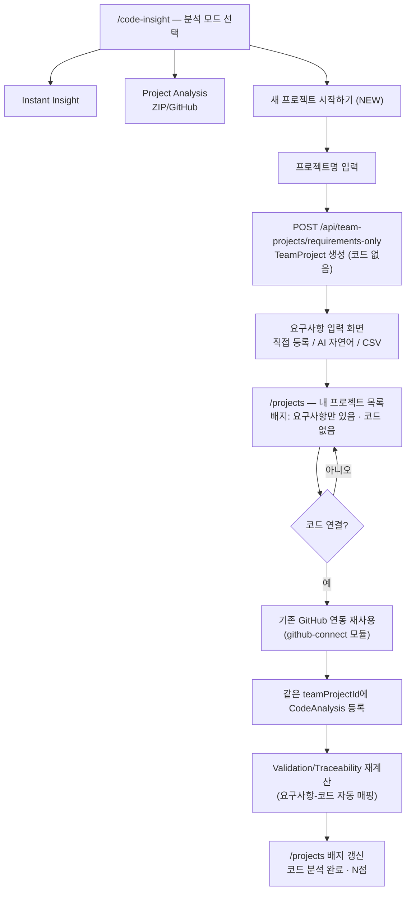

# Spec: 20_requirements_first_project_flow (요구사항 우선 프로젝트 생성 플로우 — ReqFlow 통합)

> 대상: `code-vi-internal/code-vi-back`(NestJS), `code-vi-internal/code-vi-front`(React) — 외부 저장소
> `C:/requirements-management-system`(ReqFlow, 이하 "원본")의 요구사항 관리 기능을 RE:FACTORY의
> "새 프로젝트 시작하기" 플로우로 이식한다.
> 관련 화면: `/code-insight`(3번째 카드 신설), 신규 `/projects`("내 프로젝트" 목록)

---

## 0. 사실 확인 (현재 상태)

작성 전 두 저장소를 실제로 읽고 확인한 사실이다. 아래 사실에 근거하지 않은 설계는 이 문서에 없다.

### 0.1 CodeVi — 현재 존재하는 것

- `code-vi-front/src/App.tsx`: `<BrowserRouter>` 단일 트리. 현재 라우트에 `/projects`, `/projects/new`는
  **존재하지 않는다.** 사용자가 제시한 두 스크린샷(`refactory.store/projects`, `/projects/new`)은
  아직 구현되지 않은 목표 화면이다.
- `code-vi-front/src/pages/CodeInsight/CodeInsight.tsx`: "분석 모드 선택" 화면이 실존하며 카드가
  **2개뿐**(Instant Insight, Project Analysis). 스크린샷의 3번째 카드("새 프로젝트 시작하기", NEW 배지)는
  없음.
- `code-vi-back/src/team-project/entities/team-project.entity.ts`: `TeamProject`는
  `teamName`, `JenkinsJobName`(NOT NULL), `sonarProjectKey`, `githubRepoFullName`/`githubDefaultBranch`
  (nullable, jej_18에서 추가 완료), `users`(M2M), `codeAnalyses`/`astSnapshots`/`apiKeys`/`metricAnalysisJobs`(O2M)만
  가진다. **요구사항(Requirement) 개념은 전무.**
- `code-vi-back/src/app.module.ts`에 `GithubConnectModule`이 이미 등록되어 있다 — jej_18 스펙(GitHub 레포 연동)은
  구현 완료 상태로 보인다. `team-project.service.ts::createJenkinsNotification`이 Jenkins/GitHub 경유로
  들어온 프로젝트만 `TeamProject`로 영속화한다.
- `code-vi-back/src/zip-analysis/zip-analysis.service.ts::analyzeZipFile`: ZIP 업로드 분석은
  **parser로 프록시해 결과 JSON만 반환하는 1회성(ephemeral) 분석**이다. `TeamProject`나 `CodeAnalysis`를
  **생성하지 않는다.** 즉 스크린샷 "내 프로젝트" 목록에 있는 `rlawogh1005-pyexamine`,
  `rlawogh1005-codingtest`(코드 분석 완료·점수 표시)는 GitHub 연동 경로로만 영속화될 수 있다.
- `code-vi-back/src/configs/typeorm.config.ts`: `type: 'mysql'`, DB명은 `.env.local.example`의
  `MYSQL_DATABASE=codevi`. `synchronize: true`(엔티티 변경이 자동으로 스키마에 반영됨, 마이그레이션 파일 없음).
- 디자인: `docs/specs/yejin_07_internal_dark_cinematic_theme_unify.md` — internal 전체가
  dark cinematic 톤(Base `#202931`, Primary Text `#EBF5FB`, Accent `#9FE7F0` 등)으로 통일되어 있다.
- AI/LLM: `code-vi-back/src/mcp/codevi-metrics-server.ts`는 메트릭 조회용 MCP 서버일 뿐, 텍스트 생성/자연어
  분석용 LLM 연동은 어디에도 없다.

### 0.2 requirements-management-system(ReqFlow) — 현재 존재하는 것

- 완전히 **별도의 React 앱**이다. `src/routes/index.tsx`가 `createBrowserRouter`로 자체 라우트 트리를
  가지며(`/dashboard`, `/requirements`, `/requirements/new`, `/analysis`, `/documents`, `/validation`,
  `/build-history`, `/settings`), CodeVi의 `<BrowserRouter>`와 통합되어 있지 않다.
- 백엔드는 **Express**(`server/index.ts`)이며 `server/db/prisma.ts`가 `@prisma/adapter-mariadb`로
  자체 MySQL 호환(MariaDB) DB에 연결한다 — `prisma/schema.prisma` 기준 `Project`, `User`, `Requirement`,
  `RequirementVersion`, `Baseline`, `AnalysisFinding`, `BuildHistory`, `ValidationDetail`, `Document`,
  `TraceabilityRecord`, `WebhookEvent`, `AppState` 모델을 가진다. **CodeVi의 `codevi` DB/TypeORM 엔티티와는
  완전히 별개**의 프로젝트·사용자 개념이다.
  - README는 "JSON DB(`server/db/reqflow.json`)"라고 설명하지만, 실제 `server/db/store.ts`는
    `import { prisma } from './prisma.ts'`로 Prisma를 사용한다 — **README가 실제 코드보다 오래된 상태**이며,
    JSON 파일/`src/mocks`는 초기 시드 데이터 원천으로만 남아있는 것으로 보인다(README와 코드 불일치,
    이번 이식 대상 선정 시 코드를 기준으로 판단했음).
- **인증이 없다.** `AppContext`가 `currentUserId`/`activeProjectId`를 세션처럼 다룰 뿐, 로그인/JWT는 없음.
- **AI 분석은 실제 LLM이 아니라 규칙 기반 휴리스틱**이다(README 8.1 "현재 한계" 명시,
  `src/mocks/aiGeneration`이 `NewRequirementPage.tsx`의 "AI 요구사항 생성" 버튼이 호출하는 실제 함수).
  화면 문구도 "Estimated Implementation Score / AI 추정치"로 이미 신중하게 표현되어 있다
  (`README.md` 상단 인용구).
- 디자인 토큰(`README.md` "디자인 시스템"): Primary `#0064FF`, Background `#F8FAFC` — **라이트 SaaS 톤**.
  CodeVi internal의 dark cinematic 톤과 정면으로 충돌한다.
- `src/pages/NewRequirementPage.tsx`: 요구사항 등록 화면이 이미 "직접 등록 / AI 자연어 생성(텍스트·파일 업로드) /
  CSV 일괄 가져오기" 3가지 입력 방식을 지원한다 — 스크린샷 카드 문구("자연어로 요구사항 입력")와 정확히 일치.
- `prisma/schema.prisma`의 `Requirement.projectId`, `BuildHistory.projectId` 등은 모두 ReqFlow 자체
  `Project.id`(string)를 참조한다 — CodeVi `TeamProject.id`(number)와 타입·개념 모두 다르다.

### 0.3 구조적 충돌 지점 (통합 시 반드시 결정해야 하는 것)

| 항목 | CodeVi | ReqFlow | 충돌 |
|---|---|---|---|
| DB | MySQL(TypeORM, `codevi`) | MySQL 호환(Prisma, 별도 DB) | 프로젝트/사용자가 두 군데에 따로 존재 |
| 인증 | JWT(OAuth 4종) | 없음 | 로그인 세션을 어느 쪽 기준으로 통일할지 |
| 프로젝트 식별자 | `TeamProject.id: number` | `Project.id: string` | "프로젝트"가 두 개의 서로 다른 개념 |
| 라우팅 | `<BrowserRouter>` 단일 트리 | `createBrowserRouter` 독립 트리 | 그대로 마운트 불가, 페이지 이식 필요 |
| 디자인 | dark cinematic ([yejin_07](yejin_07_internal_dark_cinematic_theme_unify.md)) | light SaaS | 리스킨 필요 |

이 표의 결론: **단순 파일 복사로는 끝나지 않는다.** 아래 1장에서 두 가지 통합 방식을 제시하고 하나를 권장한다.

---

## 1. 목표

**왜 필요한가**: 현재 RE:FACTORY는 "코드가 이미 있는" 프로젝트만 다룰 수 있다(ZIP/GitHub). 하지만 기획 단계,
즉 코드가 아직 없는 프로젝트도 지원하려는 것이 스크린샷의 3번째 카드("새 프로젝트 시작하기" — "코드 없이
요구사항부터")다. ReqFlow는 이 기능(요구사항 CRUD, AI 초안 생성, 코드-요구사항 추적성/검증)을 이미 PoC로
구현해 두었으므로 새로 만들지 않고 이식한다.

**사용자 흐름 요약**: `/code-insight`에서 "새 프로젝트 시작하기" 선택 → 프로젝트명 입력 →
요구사항 입력(직접/AI 자연어/CSV) → `/projects`("내 프로젝트")에 "요구사항만 있음·코드 없음" 배지로 노출 →
이후 아무 때나 프로젝트 상세에서 "코드 연결"(기존 GitHub 연동 재사용) → 연결 완료 시 요구사항-코드 자동 매핑
(Traceability/Validation) 계산 → 배지가 "코드 분석 완료·N점"으로 갱신.

### 1.1 아키텍처 결정 — 승인 전 확인 필요

두 가지 통합 방식이 가능하다. **이 결정에 따라 이후 모든 Phase가 달라지므로 승인 전 반드시 확인한다.**

#### Option A (권장) — Requirements 도메인을 code-vi-back(NestJS/TypeORM)으로 이식

- `prisma/schema.prisma`의 모델을 TypeORM 엔티티로 다시 작성해 기존 `codevi` DB에 신규 테이블로 추가한다.
- ReqFlow 자체 `Project`/`User` 모델은 이식하지 **않고** 폐기한다. 대신 **`TeamProject`를 프로젝트 개념의
  유일한 정본으로 승격**하고, `Requirement` 등 신규 테이블은 전부 `teamProjectId`(FK)로 연결한다.
- 로그인은 CodeVi의 기존 JWT를 그대로 쓴다 — ReqFlow에는 원래 인증이 없었으므로 오히려 이번 이식으로
  "누구의 프로젝트인지" 개념이 처음 생기는 셈이다.
- 장점: 로그인 1번, 프로젝트 목록 1번의 쿼리, "코드 연결 시 자동 매핑"이 같은 DB 안에서 JOIN 한 번으로 가능.
  스크린샷처럼 코드 프로젝트와 요구사항 프로젝트가 한 목록에 자연스럽게 섞여 나온다.
- 단점: `server/services/recompute.ts`(재분석), `server/lib/scoreEngine.ts`(점수 계산),
  `server/services/jenkins.ts`(빌드 시뮬레이션), `server/services/documents.ts`(문서 생성) 등 Express 전용
  로직을 NestJS 서비스로 다시 작성해야 한다. 다만 이 로직들은 순수 계산 함수에 가까워(DB I/O만 TypeORM으로
  교체) 포팅 난이도 자체는 낮다고 판단된다.

#### Option B — ReqFlow를 별도 서비스로 유지하고 프록시/iframe으로 연결

- `requirements-management-system`을 별도 컨테이너로 띄우고 code-vi-front에서 iframe 또는 리버스 프록시로
  연결한다.
- 장점: 기존 코드를 거의 그대로 재사용, 이식 비용이 가장 적음.
- 단점: 로그인이 사실상 2원화되고(SSO 별도 설계 필요), 프로젝트 개념이 두 DB에 쪼개져 "내 프로젝트" 통합
  목록을 만들려면 두 시스템의 API를 매번 합쳐야 한다. "코드 연결 시 자동 매핑"도 두 DB 간 동기화 호출이
  필요해 오히려 더 복잡해진다. 디자인 통일(dark cinematic)도 iframe 내부까지는 적용하기 번거롭다.

**본 문서는 Option A를 기준으로 Phase를 설계했다.** Option B를 원하면 이 spec을 폐기하고 다시 작성해야 한다.

### 1.2 서비스 흐름 (제안, Option A 기준)

### 1.3 추가 제안 (서비스 흐름 개선 아이디어)

- **"자동 매핑"을 눈에 보이게 만들 것을 제안한다.** 코드 연결 직후 "N개 요구사항 중 M개가 코드와 연결됨"
  같은 확인 화면 없이 그냥 배지만 바뀌면 사용자가 실제로 무슨 일이 일어났는지 알기 어렵다.
  Phase 7에 이 확인 화면을 명시적으로 포함시켰다(Phase 5·6·7 분리 배경은 각 Phase 앞의 "설계 배경" 참고).
- **ReqFlow의 7개 화면을 한 번에 다 이식하지 말 것을 제안한다.** Dashboard/Requirements/Analysis/Validation/
  Documents/BuildHistory/Settings 전체를 옮기면 스코프가 너무 커진다. 스크린샷이 실제로 약속하는 것은
  "자연어로 요구사항 입력"과 "추후 코드 연결 시 자동 매핑" 두 가지뿐이므로, **1차 범위는 Requirements +
  Validation/Traceability로 한정**하고 Documents(SRS/PRD 생성)·BuildHistory(Jenkins 시뮬레이션)는 후순위로
  분리했다(4장 Phase 7). 특히 BuildHistory는 CodeVi에 이미 **실제** Jenkins 연동이 있으므로 ReqFlow의
  "시뮬레이션"을 그대로 가져오면 오히려 혼란(가짜 빌드 vs 실제 빌드)을 줄 수 있어 별도 설계가 필요하다.
- **AI 생성은 1차 이식에서 휴리스틱을 그대로 유지할 것을 제안한다.** CodeVi에도 실제 LLM 연동이 없으므로
  ReqFlow의 규칙 기반 로직과 "AI 추정치" 문구를 그대로 가져가는 것이 기대치 관리에 맞다. 실제 LLM 연동은
  별도 스펙으로 제안할 수 있다.
- **디자인은 dark cinematic 토큰으로 재스타일링이 필수다.** 그대로 이식하면 라이트 SaaS 화면이 다크 워크스페이스
  중간에 툭 튀어나오게 된다.

---

## 2. 구현 단계 (Phases)

### Phase 0: 아키텍처 결정 확정 (사용자 확인) — ✅ 완료 (2026-07-23)

- 작업: 1.1의 Option A 채택 여부, 1차 범위(Requirements + Validation/Traceability, Documents/BuildHistory는
  후순위) 확인.
- 결과: **Option A(NestJS/TypeORM 이식) 채택**, **1차 범위는 Requirements + Validation/Traceability로 한정**
  (Documents/BuildHistory/Settings는 Phase 7로 후순위 확정 — 최초 승인 시점엔 Phase 6이었으나 Phase 5
  착수 전 재확인으로 Phase 5/6이 분리되며 밀림) — 사용자 승인 완료.

### Phase 1: 코드 없이 TeamProject 생성 가능하도록 확장 (Backend) — ✅ 완료 (2026-07-23)

- 작업:
  - `TeamProject.JenkinsJobName`, `sonarProjectKey`를 nullable로 변경.
  - `team-project.controller.ts`에 `POST /api/team-projects/requirements-only` 신규 엔드포인트(가칭) 추가 —
    `{ teamName }`만 받아 Jenkins/GitHub 없이 `TeamProject` 생성 + 현재 로그인 사용자를 `users`(M2M)에 연결
    (이 관계를 실제로 채우는 코드가 지금 전무하다는 사실은 jej_18 스펙 0.2에서도 이미 확인됨 — 이번이
    두 번째 진입점이 되므로 공용 헬퍼로 뽑는 것을 고려).
- 완료 조건:
  - `cd code-vi-internal/code-vi-back && npm run build` 통과 (nullable 컬럼 변경 후 기존 코드 컴파일 확인) — ✅
  - `POST /api/team-projects/requirements-only { "teamName": "쇼핑몰 리뉴얼 기획" }` → 201,
    응답의 `githubRepoFullName`이 `null`인 `TeamProject` 반환 — ✅ 서비스 단위 테스트로 검증
    (`team-project.service.spec.ts`, 실서버 curl 대신 채택 — 근거는 history 기록 참고)
  - 상세: [docs/history/jej/07/2026-07-23_jej_20_requirements_first_project_flow.md](../history/jej/07/2026-07-23_jej_20_requirements_first_project_flow.md)

### Phase 2: Requirement 도메인 엔티티 이식 — ✅ 완료 (2026-07-23)

- 작업: `prisma/schema.prisma`의 `Requirement`, `RequirementVersion`, `Baseline`, `AnalysisFinding`,
  `ValidationDetail`, `TraceabilityRecord`를 TypeORM 엔티티로 변환해 신규 모듈 `src/requirements/`에 배치.
  모든 FK를 ReqFlow의 `projectId: string` 대신 `teamProjectId: number`(→ `TeamProject`)로 교체.
  `Requirement`에 `teamProjectId` 인덱스 추가.
- 완료 조건:
  - 서버 기동 시(`synchronize: true`) 신규 테이블(`requirement`, `requirement_version` 등) 자동 생성 확인
    — ⚠️ **부분 검증**: 이 저장소의 `USE_SQLITE=true` 모드는 `CommonEntity.createdAt/updatedAt`의
    `timestamp` 컬럼 타입을 sqlite가 지원하지 않아 기존 엔티티 전체(본 spec과 무관, pre-existing)에서
    구동 자체가 실패한다 — 실제 MySQL 없이는 "서버 기동 → 자동 테이블 생성"을 이 샌드박스에서 재현할
    방법이 없었다. 대신 엔티티 정의가 `npm run build`를 통과하는 것으로 컴파일/타입 정합성을 확인했다.
    실제 MySQL 환경에서의 최종 확인은 `[수동 확인]`으로 남긴다(4장 참고).
  - `POST /api/requirements { teamProjectId, title, description, type, priority, ... }` → 201 — ✅
    서비스 단위 테스트로 검증(`requirements.service.spec.ts`)
  - `GET /api/requirements?teamProjectId=` → 방금 생성한 요구사항 포함 — ✅ 동일 테스트로 검증
  - 상세: [docs/history/jej/07/2026-07-23_jej_20_requirements_first_project_flow_phase2.md](../history/jej/07/2026-07-23_jej_20_requirements_first_project_flow_phase2.md)

### Phase 3: "내 프로젝트" 목록 API + 페이지 — ✅ 완료 (2026-07-23)

- 작업:
  - `GET /api/team-projects/mine`(로그인 사용자 소유 `TeamProject` 전체 조회, 각 항목에 `latestAnalysis`
    (코드, 기존 `getTeamDataWithAstData` 패턴 재사용) + `requirementsCount` 포함).
  - 상태 배지 계산 로직(백엔드 또는 프론트, 팀 컨벤션에 맞춰 결정): `latestAnalysis` 존재 →
    "코드 분석 완료 · {score}점", 없고 `requirementsCount > 0` → "요구사항만 있음 · 코드 없음".
  - 프론트: 신규 라우트 `/projects` + `MyProjects` 페이지 신설(스크린샷 레이아웃: 카드 그리드 + "새 프로젝트" 카드).
- 완료 조건:
  - `GET /api/team-projects/mine` 응답에 코드 프로젝트/요구사항 프로젝트가 함께 반환됨 — ✅
    서비스/DTO 단위 테스트로 검증(`team-project.service.spec.ts::getMyProjects`,
    `team-project-response.dto.spec.ts`)
  - [수동 확인] `/projects`에서 스크린샷과 동일하게 카드별로 올바른 배지가 표시되는지 확인 — ✅ 부분 확인:
    로컬 dev 서버(`localhost:5174/projects`)에서 페이지 렌더링·에러 상태·`GET /api/team-projects/mine`
    호출 자체는 확인했으나, 백엔드(MySQL)가 이 세션에 연결되어 있지 않아 **실제 데이터가 채워진 카드의
    최종 시각 확인은 못했다** — 실제 데이터 기준 확인은 여전히 사람이 필요.
  - 상세: [docs/history/jej/07/2026-07-23_jej_20_requirements_first_project_flow_phase3.md](../history/jej/07/2026-07-23_jej_20_requirements_first_project_flow_phase3.md)

### Phase 4: "새 프로젝트 시작하기" 카드 + 요구사항 입력 화면 — ✅ 완료 (2026-07-23)

> **라우팅 결정(Phase 3에서 확정)**: 스크린샷은 모드 선택 화면 URL을 `/projects/new`로 보여주지만,
> 실제로는 기존 `/code-insight`(2개 카드 보유)에 3번째 카드만 추가하는 방식을 택했다 — 동일한 화면을
> 위해 라우트를 두 개 두지 않기 위함(YAGNI). `MyProjects`("내 프로젝트")의 "새 프로젝트" 카드는
> `/code-insight`로 이동한다. `/projects/new`라는 URL 문구 자체가 꼭 필요하면 이후 별도로 리다이렉트만
> 추가하면 되는 선택적 후속 작업이다.

- 작업:
  - `CodeInsight.tsx`에 3번째 카드 추가(NEW 배지, 스크린샷 문구 그대로: "코드 없이 요구사항부터 — AI와 함께
    기획을 정리하고, 나중에 코드를 연결", 불릿 "자연어로 요구사항 입력" / "추후 코드 연결 시 자동 매핑").
  - 클릭 시 프로젝트명 입력 → Phase 1 API 호출 → ReqFlow `NewRequirementPage.tsx`를 이식한 요구사항 입력
    화면으로 이동. 3가지 입력 방식(직접 등록 / AI 자연어 생성 / CSV 가져오기) 그대로 유지, dark 테마 재스타일링.
- 완료 조건: [수동 확인] 새 프로젝트 생성 → 요구사항 1건 이상 등록 → `/projects`에 "요구사항만 있음" 배지로 노출.
  — ✅ 부분 확인: 로컬 dev 서버에서 3번째 카드 렌더링, `/code-insight/new` 폼, `/code-insight/new/:id/requirements`의
  3가지 입력 방식(직접 등록/AI 생성/CSV) 모두 확인. AI 목업 생성(클라이언트 로직, 인증 불필요)은 실제로
  버튼을 눌러 3개 데모 결과가 렌더링되는 것까지 확인했다. **다만 이 세션에 로그인 가능한 백엔드가 없어
  "프로젝트 생성 → 요구사항 등록 → `/projects` 배지 갱신"까지 이어지는 전체 흐름은 실제 데이터로 끝까지
  확인하지 못했다** — `POST /api/team-projects/requirements-only`가 (예상대로) 401을 반환하며 앱 전역의
  기존 401 인터셉터가 `/`로 리다이렉트하는 것까지는 확인, 이는 버그가 아니라 로그인 없이는 당연한 동작이다.
  실제 로그인 세션 기준 최종 확인은 사람이 필요.
  - 상세: [docs/history/jej/07/2026-07-23_jej_20_requirements_first_project_flow_phase4.md](../history/jej/07/2026-07-23_jej_20_requirements_first_project_flow_phase4.md)

### Phase 5 설계 배경 — 착수 전 재확인한 사실 (2026-07-23)

Phase 4까지 완료한 뒤 Phase 5(코드 연결 & 자동 매핑)를 시작하기 전에 실제 코드를 다시 확인한 결과,
원래 문구("등록 성공 시 재계산 트리거")로는 가려져 있던 세 가지 구조적 사실이 드러났다. 이 사실들 때문에
원래 하나였던 Phase 5를 **Phase 5(코드 연결 배선)** 와 **Phase 6(실제 매핑 엔진)** 로 쪼갠다.

1. **"요구사항 전용 프로젝트 상세 화면"이 아직 없다.** Phase 3의 `/projects`는 목록 카드일 뿐 클릭해도
   아무 데도 가지 않는다. "코드 연결" 버튼을 놓을 화면 자체를 Phase 5에서 새로 만들어야 한다(원래 spec은
   이 화면이 이미 있다고 가정하고 적혀 있었음 — 사실 확인 부족이었다).
2. **AST 데이터 수집은 GitHub 연동과 완전히 비동기·분리된 경로다.** `github-connect.service.ts::registerProject`가
   하는 일은 Jenkinsfile 주입 + Jenkins Job 생성 + **즉시 빌드 트리거**(`jenkins.service.ts::createPipelineJob`
   끝의 "Always trigger build after creation")뿐이다. 실제 클래스/함수 구조(`AstSnapshot`→`AstDirectory`→
   `AstFile`→`AstClass`→`AstFunction`, `ast-relational` 모듈)는 **Jenkins 파이프라인이 완주해
   `POST /api/ast-data/relational`을 호출해야만** 생성된다 — 이 호출 시점은 CI 실행 시간에 달려 있어 수초~수분
   걸릴 수 있고, `registerProject` 응답 시점에는 아직 존재하지 않는다. 즉 **"코드 연결" 버튼 클릭과 "매핑 결과
   등장" 사이에는 항상 지연이 있다** — 이 지연을 화면에서 정직하게 보여줘야 한다(1.3에서 제안했던 "N개 중 M개
   매핑됨" 확인 화면은 클릭 즉시가 아니라 첫 AST 스냅샷 도착 이후에 의미가 생긴다).
3. **ReqFlow의 매칭 엔진은 실제 코드가 아니라 고정된 목업 데이터(`src/mocks/data/codeFiles.ts`)를 대상으로
   동작한다.** `server/services/recompute.ts::computeSimilarity`가 비교하는 "코드 파일"은 프로젝트마다
   달라지지 않는 하드코딩된 표본이다 — 그대로 포팅하면 실제 사용자에게 가짜 매핑 결과를 보여주게 된다.
   **CodeVi에는 이미 실제 저장소를 파싱한 진짜 구조 데이터(`AstFile.name`, `AstClass.name`,
   `AstFunction.name`)가 있으므로**, ReqFlow의 알고리즘 *형태*(제목/설명/수용기준을 토큰화해 파일명·클래스명·
   함수명과 overlap score 계산, top-5 유사도 평균 60% + 수용기준 충족도 40% = Estimated Implementation
   Score — `src/utils/validation.ts::calculateEstimatedScore`/`calculateSimilarityAverage`)만 그대로
   가져오고, 비교 대상은 목업이 아니라 **해당 `teamProjectId`의 최신 `AstSnapshot` 실데이터**로 교체한다.
   이는 단순 포팅이 아니라 ReqFlow보다 더 정확한 업그레이드이며, spec 1.3의 "1차 이식에서 AI 생성은 목업
   유지" 제안과는 별개다(AI 생성=텍스트 생성 목업 유지, 코드 매칭=실데이터로 전환 — 목업으로 남겨두면 안
   되는 이유가 다르다: 실제 존재하는 데이터를 두고 가짜를 보여주는 것은 사용자를 오도한다).
4. **프로젝트 소유권 검증이 전무하다.** 지금 어떤 API도 "이 `teamProjectId`가 실제로 요청한 사용자의
   프로젝트인가"를 검사하지 않는다(`getMyProjects`는 본인 것만 조회하니 안전하지만, Phase 5에서
   "기존 `teamProjectId`에 코드를 연결"하는 기능을 추가하면 **임의의 로그인 사용자가 다른 사람의
   프로젝트 id를 추측해 자기 GitHub 레포를 몰래 연결할 수 있는 구멍**이 생긴다). Phase 5에서 반드시
   멤버십 검증을 추가한다 — 선택 사항이 아니라 이 기능을 추가하는 이상 필수인 보안 수정이다.

### Phase 5: 프로젝트 상세 화면 + 기존 프로젝트에 코드 연결 — ✅ 완료 (2026-07-23)

- 작업:
  - **[신규] 프로젝트 상세 화면** `/projects/:teamProjectId`(프론트): 프로젝트명 + 상태 배지(Phase 3의
    `statusLabel`) + 요구사항 목록(`GET /api/requirements?teamProjectId=`) 표시. `MyProjects`의 카드를
    클릭 가능하게 만들어 이 화면으로 연결(현재는 카드가 그냥 정적 div임).
  - **[백엔드]** `GET /api/team-projects/:id` 신규(정적 경로 `/history`/`/mine`/`/requirements-only`보다
    뒤에 등록 — 라우트 충돌 방지) — 멤버십 검증 포함 프로젝트 상세 조회.
  - **[백엔드]** `GithubConnectService.registerProject`에 `teamProjectId`(선택) 파라미터 추가:
    - 값이 있으면 "기존 프로젝트에 연결" 모드: 해당 `TeamProject`를 조회 → **요청한 사용자가
      `project.users`에 포함되어 있는지 검증**(없으면 403) → 이미 `githubRepoFullName`이 있으면 409(이미
      연결됨) → Jenkinsfile 주입 + Jenkins Job 생성은 기존 로직 재사용 → 새 row를 만들지 않고 기존 row의
      `JenkinsJobName`/`sonarProjectKey`/`githubRepoFullName`/`githubDefaultBranch`만 갱신.
    - 값이 없으면 기존 동작(신규 프로젝트 생성) 그대로 유지 — Project Analysis(2번째 카드) 경로는 영향 없음.
  - **[백엔드]** OAuth `state`(JWT)에 `teamProjectId`를 함께 실어(`signGithubConnectState`/
    `verifyGithubConnectState` 확장) GitHub 인가 왕복 후에도 어느 프로젝트에 연결하려던 것인지 유지 —
    콜백 리다이렉트(`auth.controller.ts::githubAuthRedirect`)가 `&teamProjectId=`를 붙여 돌려보낸다.
  - **[프론트]** 프로젝트 상세 화면에 코드가 없는 경우에만 "코드 연결" 버튼 노출 → 기존
    `GitHubConnect.tsx`를 `/code-insight/github?teamProjectId=`로 재사용(신규 라우트 없음 — 기존 컴포넌트가
    `teamProjectId`를 있으면 첨부 모드로, 없으면 기존 신규 생성 모드로 동작하도록 분기). OAuth 왕복 후
    쿼리스트링이 정리(navigate replace)돼도 값이 사라지지 않도록 최초 렌더 시점에 `useState`로 고정.
  - 연결 완료 후에는 프로젝트 상세 화면(`/projects/:id`)으로 이동하며, 코드가 연결됐지만 아직 분석 전이면
    "Jenkins 빌드가 완료되면 매핑 결과가 표시됩니다" 같은 **지연을 정직하게 알리는 안내 문구**를 표시한다
    (위 사실 확인 2번 근거) — Phase 7이 완료되기 전까지는 매핑 결과 자체를 보여줄 수 없다.
- 완료 조건:
  - `POST /api/github/projects { owner, repo, teamProjectId }`(다른 사용자의 프로젝트 id) → 403 — ✅
    `github-connect.service.spec.ts`로 검증
  - `POST /api/github/projects { owner, repo, teamProjectId }`(본인 프로젝트, 이미 연결됨) → 409 — ✅ 동일
  - `POST /api/github/projects { owner, repo, teamProjectId }`(본인 프로젝트, 미연결) → 200/201,
    **새 `TeamProject` row가 생기지 않고** 기존 row가 갱신됨 — ✅ 동일 테스트로 검증(`update` 호출 확인)
  - `GET /api/team-projects/:id`(타인 프로젝트) → 403, (존재하지 않음) → 404 — ✅ `team-project.service.ts`
    로직에 포함(전용 스펙 테스트는 작성하지 않음 — `getTeamDataWithAstData` 재사용 + 기존 멤버십 검증 패턴)
  - [수동 확인] `/projects/:id`에서 요구사항 목록이 보이고, "코드 연결" 완료 후 안내 문구가 표시됨 — ✅
    부분 확인: 로컬 dev 서버에서 `/projects/:id`, `/code-insight/github?teamProjectId=` 렌더링과 정확한
    API 호출 경로(`GET /api/team-projects/:id`, `GET /api/requirements?teamProjectId=`)까지 확인, 콘솔
    에러 없음. 로그인 세션이 없어 두 경로 모두 401 → 앱 전역 인터셉터가 `/`로 리다이렉트(기존 동작,
    버그 아님)까지만 재현. 실제 로그인 기준 최종 확인은 사람이 필요.
  - 상세: [docs/history/jej/07/2026-07-23_jej_20_requirements_first_project_flow_phase5.md](../history/jej/07/2026-07-23_jej_20_requirements_first_project_flow_phase5.md)

### Phase 6 설계 배경 — 순서 재조정 (2026-07-23)

Phase 6(코드 매핑 엔진) 착수 전, 사용자와 순서를 다시 논의했다. ReqFlow의 `server/routes/dashboard.ts` +
`DashboardKpiCards.tsx`/`DashboardStatsStrip.tsx`/`StatusDistributionChart.tsx`를 다시 읽어보니 Dashboard가
집계하는 지표는 두 종류로 뚜렷이 나뉜다:

1. **코드/Jenkins와 무관하게 지금 당장 계산 가능한 것**: 전체 요구사항 수, 기능/비기능 비율, 우선순위 분포,
   마감 임박/지연(`DueDateAlertsWidget` — `dueDate`+`status`만 봄), 그리고 **AI 분석 findings(중복/충돌/누락
   후보)** — `recompute.ts::buildAnalysisFindings`는 요구사항 제목/설명/수용기준끼리의 텍스트 overlap과
   키워드 조합만 보는 순수 텍스트 휴리스틱이라 코드 연결 여부와 전혀 무관하다.
2. **Phase 7(코드 매핑 엔진)이 있어야 의미가 생기는 것**: `DashboardKpiCards`의 "추정 구현 점수"·"검증된
   요구사항"·"추적성 링크"·"최신 빌드" 카드, `StatusDistributionChart`의 "상태 분포"(실제로는 워크플로
   상태가 아니라 **추정 구현 점수 기준** 분포임 — 컴포넌트 설명 "추정 구현 점수 기반 상태 분포" 확인). 전부
   `implementationScore`/`ValidationDetail`/`TraceabilityRecord`/빌드 이력에 의존하는데, 지금은
   `implementationScore`가 전부 0이라 이 카드들을 지금 만들면 "전부 미구현"으로만 보여 오히려 오해를 준다.

**결론**: 1번 그룹(코드 매핑과 무관한 요구사항 대시보드 + AI 분석)을 새 **Phase 6**으로 앞당기고, 원래
Phase 6(코드 매핑 엔진)을 **Phase 7**로, 후순위였던 Phase 7(Documents/BuildHistory/Settings)을 **Phase 8**로
민다. 이렇게 하면 실제 Jenkins/GitHub 파이프라인 없이도 **이 세션 안에서 실제 데이터로 끝까지 검증 가능한
Phase를 먼저 끝낼 수 있다** — Phase 5까지 반복됐던 "코드/외부 인프라 의존 때문에 수동 확인으로만 남긴다"는
제약이 이번 Phase에는 없다.

### Phase 6: 요구사항 대시보드 + AI 분석(Analysis) findings — ✅ 완료 (2026-07-24)

- 작업:
  - **[백엔드]** `requirements` 모듈에 분석 엔진 추가(ReqFlow `server/services/recompute.ts`의
    `buildAnalysisFindings` 이식 — 코드 의존 없음, 그대로 포팅 가능):
    - `recomputeFindings(teamProjectId)`: 해당 프로젝트의 모든 `Requirement`를 쌍(pair)으로 비교 →
      제목+설명+수용기준을 토큰화해 overlap ≥ 0.55면 `duplicate` finding, 보안/세션/권한 관련 키워드 조합이
      동시에 나오면 `conflict` finding, 로그인/회원가입/비밀번호 재설정/예외 처리/테스트 케이스 키워드가
      프로젝트 전체 요구사항에서 하나도 안 보이면 `omission` finding — Phase 2에서 스키마만 만들어둔
      `AnalysisFinding` 엔티티에 저장(기존 findings는 교체).
    - `POST /api/requirements/:teamProjectId/analysis/recompute` 신규(ReqFlow의 "AI 분석 실행" 버튼과
      동일하게 수동 트리거 — 요구사항이 적을 땐 매번 자동 계산할 필요가 없어 버튼 트리거로 충분하다고 판단).
    - `GET /api/requirements/:teamProjectId/summary` 신규: 전체/기능/비기능 개수, 우선순위 분포, 마감
      임박·지연 목록, findings 요약(`{ duplicateCount, conflictCount, missingCount, totalFindings,
      recentFindings }`)을 한 번에 반환 — 대시보드 화면 하나가 API 하나로 그려지도록.
  - **[프론트]** `/projects/:teamProjectId`(Phase 5의 프로젝트 상세 화면)를 확장한다 — 새 라우트를 만들지
    않는다(요구사항 목록이 이미 이 화면에 있어 데이터가 겹침):
    - KPI 카드 로우: 전체 요구사항 수, 기능/비기능, 우선순위별 분포
    - AI 분석 카드: 중복/충돌/누락 후보 개수 + 최근 findings 목록 + "AI 분석 실행" 버튼(recompute 호출)
    - 마감 임박/지연 위젯
    - **[명시적 보류]** 구현 완료/부분/미구현 분포, 추적성 링크, 최신 빌드 카드는 Phase 7 완료 후 추가한다
      — 지금 넣으면 항상 "전부 미구현"만 나와 혼란을 준다(위 설계 배경 참고).
- 완료 조건:
  - `POST /api/requirements/:teamProjectId/analysis/recompute` 호출 후 유사한 제목의 요구사항 2개를 넣으면
    `duplicate` finding이 생성됨 — ✅ `requirements.service.spec.ts`로 검증(제목이 동일한 요구사항 2개 →
    `duplicate` finding 생성 확인, 재계산 시 기존 findings가 교체되는지도 함께 검증)
  - `GET /api/requirements/:teamProjectId/summary`가 개수/우선순위 분포/findings 요약을 정확히 반환함 — ✅
    동일 테스트로 검증(마감 지난/한참 남은 요구사항 각 1건 → `dueDateAlerts`에 지난 것만 포함, 우선순위
    분포·기능/비기능 개수 정확히 집계됨을 확인)
  - 멤버십 검증(다른 프로젝트 멤버는 403) — ✅ 동일 테스트로 검증. 이 두 엔드포인트는 Phase 2의 기존
    `POST/GET /api/requirements`에는 없던 멤버십 검증을 처음 추가했다(Phase 5에서 세운 "새 프로젝트
    스코프 엔드포인트는 멤버십 검증 필수" 원칙을 따름) — Phase 2 엔드포인트 자체는 이번 범위 밖이라 그대로
    두었다(알려진 격차로 history에 기록).
  - [수동 확인] `/projects/:id`에서 KPI 카드·AI 분석 카드·마감 위젯이 실제 등록된 요구사항 데이터를 반영해
    렌더링됨 — 부분 확인: 이 세션에 로컬 MySQL(포트 3306, Windows 서비스)이 떠 있지만 프로젝트가 실제로
    쓰는 DB는 `.env`상 포트 13306(docker-compose 전용)이고 이 포트는 응답이 없었다 — Docker Desktop
    데몬 자체가 꺼져 있어 이번에도 실제 백엔드 기동은 불가능했다(Docker 데몬을 직접 띄우는 건 이 Phase
    범위를 넘는 시스템 변경이라 보류). 대신 브라우저에서 `/projects/1`에 직접 접속해 세 API
    (`GET /api/team-projects/1`, `GET /api/requirements?teamProjectId=1`,
    `GET /api/requirements/1/summary`)가 정확한 경로로 호출되고, 백엔드가 없을 때(502) 화면이 깨지지
    않고 에러 문구를 정상적으로 보여주는 것까지 확인했다. 실제 데이터가 채워진 화면은 실제 DB가 연결된
    환경에서 사람이 확인해야 한다.
  - 상세: [docs/history/jej/07/2026-07-24_jej_20_requirements_first_project_flow_phase6.md](../history/jej/07/2026-07-24_jej_20_requirements_first_project_flow_phase6.md)

### Phase 7: 요구사항-코드 자동 매핑 엔진 + 확인 화면

- 작업:
  - **[백엔드]** `requirements` 모듈에 매칭 엔진 추가(ReqFlow `server/services/recompute.ts` +
    `src/utils/validation.ts`의 알고리즘 이식, 대상 데이터는 위 사실 확인 3번대로 실제
    `AstFile`/`AstClass`/`AstFunction`으로 교체):
    - `recomputeForTeamProject(teamProjectId)`: 해당 프로젝트의 최신 `AstSnapshot`을 조회 →
      `AstFile`+`AstClass`+`AstFunction`을 "코드 파일 후보" 목록으로 변환(파일명/클래스명/함수명을 토큰화 대상
      텍스트로 사용) → 각 `Requirement`(제목+설명+수용기준)와 토큰 overlap score 계산 → top-5 유사도 평균
      60% + 수용기준 충족도 40%로 `implementationScore` 갱신, `ValidationDetail`/`TraceabilityRecord`
      (Phase 2에서 스키마만 만들어둔 엔티티) 채움.
    - 트리거 지점 두 곳: (1) `AstRelationalController.saveAstData()` 성공 직후 해당 `teamProjectId`에 대해
      **자동** 실행(신규 CI 빌드로 코드가 바뀔 때마다 매핑도 최신화) — `team-project.service.ts`의 기존
      "커밋 후 백그라운드로 후처리" 패턴과 동일하게 fire-and-forget으로 실행. (2) 프로젝트 상세 화면의
      "재검증" 버튼으로 수동 실행(`POST /api/requirements/recompute?teamProjectId=`) — 요구사항을 나중에
      추가했거나 그냥 다시 계산하고 싶을 때.
    - `GET /api/requirements/:teamProjectId/mapping-summary` 신규: `{ total, mapped, requirements: [...] }`
      형태로 "N개 중 M개 매핑됨" 계산 결과 반환(`mapped` = `implementationScore`가 임계값 이상인 요구사항 수).
  - **[프론트]** 프로젝트 상세 화면에 매핑 요약 배너("N개 요구사항 중 M개가 코드와 연결됨") + 요구사항별
    Implementation Score 배지 추가. "재검증" 버튼 연결. Phase 6에서 보류했던 구현 완료/부분/미구현 분포,
    추적성 링크, 최신 빌드 KPI 카드를 여기서 채운다.
- 완료 조건: 실제 GitHub 레포에 대해 최소 1회 Jenkins 빌드 + AST 수집이 끝난 뒤, 프로젝트 상세 화면에
  매핑 요약과 요구사항별 점수가 표시되고 `/projects` 배지가 "코드 분석 완료 · N점"으로 갱신됨(Phase 3에서
  이미 구현된 배지 로직 — `latestAnalysis` 존재만으로 갱신되므로 이 부분은 추가 작업 불필요, 확인만 한다).
  — [수동 확인 필수] 실제 Jenkins/GitHub 파이프라인이 있는 환경 필요, 이 세션에서는 재현 불가.

### Phase 8 (후순위 — 별도 승인 후 별도 spec으로 진행)

- Documents(SRS/PRD/BRS 생성), Build History(Jenkins 시뮬레이션), Settings 이식.
- 본 문서 범위 밖. Phase 7까지 완료 후 재검토.

---

## 3. 의존성

- 선행 spec: `jej_18_github_repository_integration`(GitHub 레포 연동, 구현 완료 — `github-connect` 모듈을
  Phase 5에서 재사용/확장)
- 신규 패키지: 없음. ReqFlow의 `@prisma/client`/`@prisma/adapter-mariadb`는 도입하지 않는다
  (`prisma/schema.prisma`는 엔티티 설계 참고 자료로만 사용, 실제 구현은 기존 TypeORM 컨벤션을 따름).
- 영향받는 계약:
  - `TeamProject` 엔티티 컬럼 nullable 변경(`synchronize: true`라 자동 반영되나 기존 row 확인 필요)
  - 신규 API 다수(`/api/team-projects/requirements-only`, `/api/team-projects/mine`, `/api/requirements` 등)
  - `github-connect` 모듈의 `registerProject` 시그니처 확장(기존 프로젝트에 연결하는 경로 추가)

## 4. 검증 계획

- Phase 1~3: `/verify` 게이트(백엔드 유닛 테스트 + 타입체크)로 자동 검증.
- Phase 4~7: E2E 자동화 미도입 상태(AGENTS.md 3.3, 정직한 공백) → `[수동 확인]` 항목으로 화면 비교(3장 카드
  문구/배지 텍스트/색상, dark 테마 일관성)를 사람이 직접 확인한다. 이 중 **Phase 6은 코드/외부 인프라 의존이
  없어 로직 자체는 이 세션에서 실제 데이터로 끝까지 검증 가능**하다(Phase 6 설계 배경 참고) — 로그인 세션이
  없어 화면 렌더링만 수동 확인으로 남는다. 반면 **Phase 7은 실제 Jenkins/GitHub 파이프라인이 있는 환경이
  아니면 끝까지 재현할 수 없다**(Phase 7 완료 조건 참고).
- **[수동 확인, Phase 2 관련]**: 이 개발 샌드박스에는 실제 MySQL이 연결되어 있지 않아(`USE_SQLITE=true`
  모드는 `CommonEntity`의 `timestamp` 컬럼을 sqlite가 지원하지 않아 기존 엔티티 전체에서 구동 자체가
  실패함 — pre-existing, 본 spec과 무관) `synchronize: true`가 실제 MySQL에서 `requirement`,
  `requirement_version`, `baseline`, `analysis_finding`, `validation_detail`, `traceability_record`
  테이블을 의도대로 생성하는지는 실제 `codevi` DB가 연결된 환경(로컬 docker-compose 등)에서 서버를
  한 번 기동해 확인이 필요하다.
