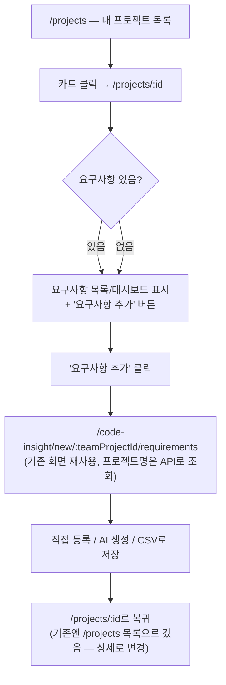

# Spec: 21_existing_project_requirements_management (기존 프로젝트에 요구사항 추가)

> 대상: `code-vi-internal/code-vi-back`(`requirements` 모듈), `code-vi-internal/code-vi-front`
> (`ProjectDetail`, `NewRequirement` 페이지)
> 관련 화면: `/projects/:teamProjectId`(프로젝트 상세), `/code-insight/new/:teamProjectId/requirements`
> (요구사항 입력)

---

## 0. 사실 확인 (현재 상태)

jej_20(Phase 1~6) 완료 후 실제 코드를 다시 확인한 결과다.

- `code-vi-front/src/pages/ProjectDetail/ProjectDetail.tsx`: `/projects/:teamProjectId`는 이미 코드
  프로젝트/요구사항 전용 프로젝트 구분 없이 요구사항 목록·KPI·AI 분석 카드를 전부 보여준다(jej_20 Phase 6).
  **하지만 요구사항을 "추가"하는 버튼이 이 화면에 없다.**
- 요구사항을 추가할 수 있는 유일한 진입점은 `/code-insight/new`(프로젝트 이름 입력) →
  `/code-insight/new/:teamProjectId/requirements`(요구사항 입력) 뿐이다(jej_20 Phase 4). 이 흐름은
  `teamProjectService.createRequirementsOnlyProject()`로 **매번 새 `TeamProject`를 만드는 것을 전제**로
  설계되어 있어, 이미 존재하는 프로젝트(특히 GitHub로 코드가 연결된 프로젝트)에는 요구사항을 추가할 방법이
  전혀 없다.
- `code-vi-front/src/pages/CodeInsight/NewRequirement/NewRequirement.tsx`(1~16행): 프로젝트 이름을
  `useLocation().state.teamName`으로만 받는다. `/projects/:id`에서 직접 이동하거나 이 URL을 새로고침하면
  `location.state`가 비어 있어 제목이 `undefined ?? '요구사항 입력'`(플레이스홀더)로만 나온다 — jej_20
  Phase 4 history에서 이미 알려진 한계로 기록됐던 부분("새로고침 시 사라지는 건 감수").
  `teamProjectId`는 라우트 파라미터라 이 문제와 무관하게 항상 정확하다.
- `code-vi-back/src/requirements/requirements.controller.ts::create`(31~36행)와 `::findAll`(38~42행):
  **로그인 검증(`AuthGuard()`)만 있고 프로젝트 멤버십 검증이 없다.** 즉 로그인한 사용자라면 누구든
  `teamProjectId`만 알면(추측하거나 URL에서 유출되면) 남의 프로젝트에 요구사항을 만들거나 남의 요구사항
  목록을 조회할 수 있다. 이 격차는 jej_20 Phase 6 history에 "알려진 격차, 이번 범위 밖"으로 이미 기록해둔
  상태다.
- `code-vi-back/src/requirements/requirements.service.ts`: Phase 5/6에서 만든
  `assertMembership(userId, teamProjectId)` private 메서드가 이미 존재한다(`getProjectDetail`,
  `recomputeFindings`, `getSummary`에서 재사용 중) — `create`/`findByTeamProject`에도 그대로 재사용
  가능하다.
- `GET /api/team-projects/:id`(jej_20 Phase 5)가 이미 있어 프론트에서 프로젝트명을 API로 조회할 수 있다
  (`teamProjectService.getProjectDetail`).

## 1. 목표

**왜 필요한가**: 지금은 "새 프로젝트 시작하기"로 만든 프로젝트에만 요구사항을 넣을 수 있다. 이미 GitHub로
코드를 연결해둔 기존 프로젝트, 또는 예전에 만든 요구사항 전용 프로젝트에 요구사항을 이어서 추가할 방법이
없다 — 요구사항 관리는 "한 번만 쓰는 기능"이 아니라 프로젝트 생애주기 내내 계속 쓰는 기능이어야 한다.

**결정된 방향(사용자와 논의 완료)**: 별도의 "프로젝트 선택" 화면을 새로 만들지 않는다. `/projects`(내
프로젝트 목록)가 이미 그 역할을 하고 있으므로(카드 클릭 → `/projects/:id`), **`/projects/:id`에 "요구사항
추가" 버튼만 추가**해 기존 요구사항 입력 화면(`/code-insight/new/:teamProjectId/requirements`)을 그대로
재사용한다. 새 화면을 만들면 `/projects`와 데이터가 겹치는 화면이 하나 더 생겨 유지보수 부담만 커진다는
것이 이유였다.

### 1.1 사용자 흐름

---

## 2. 구현 단계 (Phases)

### Phase 1: 백엔드 — 요구사항 CRUD에 멤버십 검증 추가 — ✅ 완료 (2026-07-24)

- 작업:
  - `RequirementsService.create(dto)` → `create(userId, dto)`로 변경, 시작 시
    `assertMembership(userId, dto.teamProjectId)` 호출.
  - `RequirementsService.findByTeamProject(teamProjectId)`는 `countByTeamProjectIds`(Phase 3, "내 프로젝트"
    배지 계산용) 등 **내부에서도 재사용 중**이므로 시그니처를 그대로 바꾸지 않는다. 대신 컨트롤러 전용의
    새 공개 메서드 `findByTeamProjectForUser(userId, teamProjectId)`를 추가해 멤버십 검증 후
    `findByTeamProject`를 호출하는 방식으로 분리한다(내부 재사용 경로와 외부 API 경로를 섞지 않기 위함).
  - `RequirementsController.create`/`findAll`이 `@GetUser() user`를 받아 위 변경된 메서드에 넘기도록 수정.
- 완료 조건:
  - 본인 프로젝트가 아닌 `teamProjectId`로 `POST /api/requirements` 호출 시 403 — ✅
    `requirements.service.spec.ts`로 검증
  - 본인 프로젝트가 아닌 `teamProjectId`로 `GET /api/requirements?teamProjectId=` 호출 시 403 — ✅ 동일
  - 기존 정상 경로(본인 프로젝트)는 그대로 동작 — ✅ 기존 `create`/`findByTeamProject` 테스트를 새 시그니처에
    맞게 갱신, 신규 케이스 3건 추가(총 28/28 pass)
  - 상세: [docs/history/jej/07/2026-07-24_jej_21_existing_project_requirements_management_phase1.md](../history/jej/07/2026-07-24_jej_21_existing_project_requirements_management_phase1.md)

### Phase 2: 프론트 — "요구사항 추가" 진입점 + 프로젝트명 API 조회로 전환 — ✅ 완료 (2026-07-24)

- 작업:
  - `ProjectDetail.tsx`에 "요구사항 추가" 버튼 추가(요구사항 섹션 상단, 코드 연결 여부와 무관하게 항상
    노출) → `navigate('/code-insight/new/:teamProjectId/requirements')`(새 라우트 아님, 기존 라우트 재사용).
  - `NewRequirement.tsx`: 프로젝트명을 `location.state.teamName` 대신 `teamProjectService.getProjectDetail
    (projectId)`로 조회(마운트 시 1회) — 새로고침/직접 진입에도 항상 정확한 이름이 뜨도록 수정. 로딩 중에는
    기존처럼 플레이스홀더("요구사항 입력") 유지.
  - 저장 완료 후 이동 경로를 `/projects`(목록) → **`/projects/:teamProjectId`(상세)로 변경** — 방금 추가한
    요구사항이 바로 보이는 화면으로 돌아가는 게 더 자연스럽다(기존 "새 프로젝트 시작하기" 흐름에서도 동일하게
    적용됨 — 새 프로젝트든 기존 프로젝트든 저장 후 착지점을 통일).
- 완료 조건:
  - [수동 확인] `/projects/:id`에서 "요구사항 추가" 클릭 → 입력 화면에 프로젝트명이 정확히 표시됨(뒤로가기
    없이 URL 직접 진입해도 동일) → 저장 후 `/projects/:id`로 복귀해 방금 추가한 요구사항이 목록에 보임 —
    부분 확인: 브라우저에서 `/projects/1` 접속 시 `GET /api/team-projects/1`,
    `GET /api/requirements?teamProjectId=1`, `GET /api/requirements/1/summary`가 정확한 경로로 호출되고
    (이번엔 백엔드 프로세스가 응답해 502 대신 401을 반환 — 로그인 세션이 없어 여전히 랜딩으로 리다이렉트),
    콘솔 에러 없음을 확인. 로그인 세션이 없어 버튼 클릭 → 입력 → 저장 → 복귀까지 전체 흐름은 사람이
    확인해야 한다.
  - 상세: [docs/history/jej/07/2026-07-24_jej_21_existing_project_requirements_management_phase2.md](../history/jej/07/2026-07-24_jej_21_existing_project_requirements_management_phase2.md)

---

## 3. 의존성

- 선행 spec: `jej_20_requirements_first_project_flow`(Phase 2 요구사항 CRUD, Phase 4 요구사항 입력 화면,
  Phase 5 `GET /api/team-projects/:id`, Phase 6 `assertMembership` 패턴 — 전부 재사용)
- 신규 라우트/신규 화면 없음 — 기존 화면 재배선만 발생.
- 영향받는 계약: `RequirementsService.create`/컨트롤러 시그니처 변경(내부 호출부 없음, `create`는
  `requirements.controller.ts`에서만 호출됨 — 영향 범위 작음).

## 4. 검증 계획

- Phase 1: `/verify` 게이트(백엔드 유닛 테스트 + 타입체크)로 자동 검증 — 멤버십 검증은 기존
  `github-connect.service.spec.ts`/`requirements.service.spec.ts`와 동일한 mocked repository 패턴으로
  테스트 가능(외부 인프라 불필요).
- Phase 2: E2E 자동화 미도입 상태(AGENTS.md 3.3) → `[수동 확인]`. 로그인 세션이 없는 이 세션에서는 화면
  렌더링·API 호출 경로까지만 확인 가능(jej_20 Phase 4/5/6과 동일한 제약).
