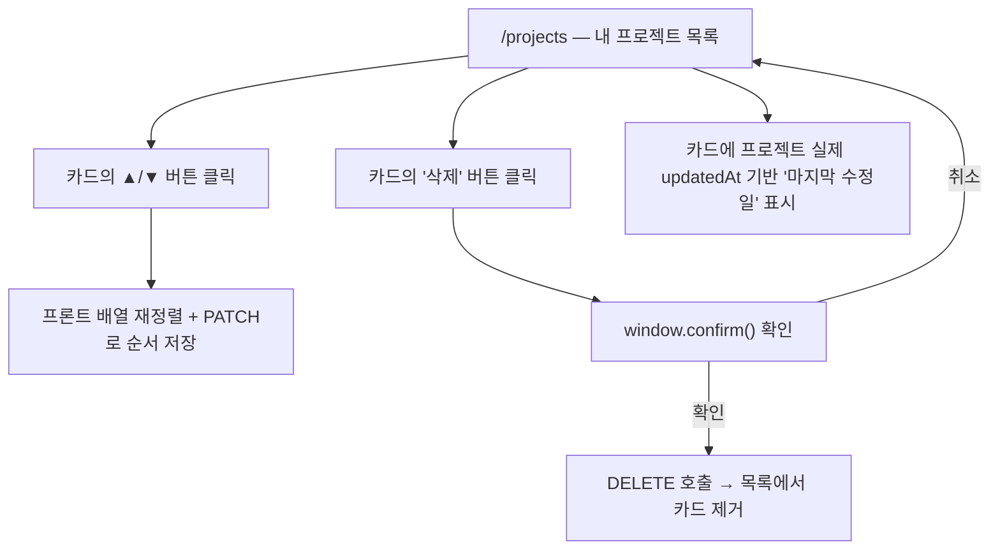

# Spec: 22_my_projects_reorder_delete (내 프로젝트 목록 순서변경/삭제 + 마지막 수정일 표시)

> 대상: `code-vi-internal/code-vi-back`(`team-project` 모듈), `code-vi-internal/code-vi-front`
> (`MyProjects` 페이지)
> 관련 화면: `/projects` (내 프로젝트 목록)

---

## 0. 사실 확인 (현재 상태)

- 라우트: `code-vi-front/src/App.tsx` — `/projects` → `MyProjects` 컴포넌트.
- 목록 컴포넌트: `code-vi-front/src/pages/MyProjects/MyProjects.tsx`.
  - `43-67행`: `teamProjectService.getMyProjects()`로 목록을 받아 `projects` state에 저장, 순서는 받은 배열
    그대로 렌더링(`80행` `projects.map`) — 프론트 자체 정렬/재배열 로직 없음.
  - `19-41행` `ProjectCard`: 카드 클릭 시 `/projects/:id`로 이동만 가능. 순서변경 버튼, 삭제 버튼 **없음**.
  - `8-17행` `formatUpdatedAt`: `project.codeAnalysis?.createdAt`(최신 코드분석의 생성일)을 "YYYY.MM.DD
    업데이트"로 표시 — **이름과 달리 프로젝트 자체의 수정일이 아니다.** 코드 분석이 없는 프로젝트
    (`requirements_only`/`empty`)는 `codeAnalysis`가 null이라 이 텍스트 자체가 아예 렌더링되지 않는다
    (`38행` `{updatedAt && ...}`).
- 서비스: `code-vi-front/src/services/teamProjectService.ts` — `getMyProjects` → `GET
  /api/team-projects/mine`만 존재. 삭제/순서변경 API 호출 함수 없음.
- 인터페이스: `code-vi-front/src/interface/teamProject.interface.ts` `TeamProjectSummary` —
  `updatedAt` 필드 없음.
- 백엔드 컨트롤러: `code-vi-back/src/team-project/team-project.controller.ts` — `POST /`,
  `POST /requirements-only`, `GET /history`(AuthGuard 있음, PR #61 리뷰 대응 완료), `GET /mine`,
  `GET /:id`(ProjectMemberGuard)만 존재. **DELETE 엔드포인트 없음.**
- 백엔드 서비스: `code-vi-back/src/team-project/team-project.service.ts` — 삭제(`delete`/`remove`)
  로직 전무.
  - `getMyProjects`: `.orderBy('project.updatedAt', 'DESC')`로 정렬 — 사용자 커스텀 순서 개념 없음.
  - `getProjectDetail(teamProjectId)`: 멤버십 검증은 `ProjectMemberGuard`(jej_22 이전 세션에서 통합,
    PR #61 리뷰 #10)가 컨트롤러 진입 시점에 수행 — 삭제 API도 동일 가드 재사용 가능.
  - `getTeamDataWithAstData(projectId)`: `users` relation을 포함해 프로젝트를 조회하는 기존 메서드.
- 엔티티: `code-vi-back/src/team-project/entities/team-project.entity.ts` — `order`/`sortOrder`/
  `position` 계열 컬럼 **없음**. `CommonEntity`를 상속해 `createdAt`/`updatedAt` 컬럼은 이미 DB에
  존재하지만 `TeamProjectResponseDto`가 노출하지 않는다. `JenkinsJobName`엔 유니크 인덱스가 이미
  적용돼 있음(PR #61 리뷰 #4, 무관하지만 참고).
- DB: `code-vi-back/src/configs/typeorm.config.ts` `synchronize: true` — 마이그레이션 파일 없이
  엔티티에 컬럼을 추가하면 dev DB 스키마에 자동 반영됨.
- 삭제 확인 UI 기존 패턴: `code-vi-front/src/pages/CodeInsight/GitHubConnect/GitHubConnect.tsx`에서
  이미 `window.confirm(...)`을 사용 중 — 이번 기능도 별도 모달 없이 동일 패턴 재사용.
- 순서변경 UI: 드래그앤드롭 라이브러리가 프론트에 전혀 설치돼 있지 않음 — 카드 내 위/아래 이동
  버튼으로 구현(새 패키지 도입 없음).
- 관련 기존 spec: `jej_20_requirements_first_project_flow.md`(Phase 3)가 `/projects`·`getMyProjects`·
  `TeamProjectResponseDto`의 원 스펙.

## 1. 목표

**왜 필요한가**: "내 프로젝트" 목록이 늘어날수록 원하는 프로젝트를 찾기 위해 순서를 바꾸거나, 더 이상
쓰지 않는 프로젝트를 정리(삭제)할 방법이 필요하다. 또한 카드에 표시되는 "업데이트" 날짜가 실제로는
코드 분석 생성일이라 프로젝트 자체가 언제 마지막으로 바뀌었는지 알 수 없다 — 실제 `updatedAt`을
노출해 정확한 정보를 제공한다.

**결정된 방향(사용자와 논의 완료)**:
- 순서변경은 드래그앤드롭이 아니라 카드 내 **위/아래 이동 버튼**으로 구현한다(신규 의존성 없음).
- 삭제 확인은 커스텀 모달이 아니라 기존에 쓰던 **`window.confirm()`**을 재사용한다.
- 순서는 `TeamProject` 엔티티에 저장되는 **전역(팀 공유) 값**이다 — 프로젝트 멤버별로 다른 순서를 갖는
  기능(사용자별 개인 정렬)은 이번 범위에 포함하지 않는다.
- 순서변경은 프로젝트의 "마지막 수정일"에 영향을 주지 않는다(단순 정렬 조작을 콘텐츠 변경으로 취급하지
  않기 위함) — Phase 2에서 `updatedAt`을 건드리지 않는 쿼리 방식을 사용해 이를 보장한다.

### 1.1 사용자 흐름

---

## 2. 구현 단계 (Phases)

### Phase 1: 백엔드 — 프로젝트 삭제 API

- 작업:
  - `TeamProjectService`에 `deleteProject(teamProjectId: number): Promise<void>` 추가.
    `getTeamDataWithAstData(teamProjectId)`로 조회 → 없으면 `NotFoundException` → 통과 시
    `teamProjectRepository.remove(project)`로 삭제(`OneToMany` 관계들이 `cascade: true`이므로
    `codeAnalyses`/`astSnapshots`/`apiKeys`/`metricAnalysisJobs`도 함께 정리되는지 테스트로 확인).
    멤버십 검증은 서비스가 아니라 컨트롤러의 `ProjectMemberGuard`가 담당(jej_22 이전 세션 PR #61
    리뷰 #10 패턴 재사용) — `getProjectDetail`처럼 `teamProjectId`만 받는다.
  - `TeamProjectController`에 `DELETE /api/team-projects/:id` 추가 (`@UseGuards(AuthGuard(),
    ProjectMemberGuard)`, `@ProjectMember({ source: 'params', field: 'id' })`,
    `@HttpCode(HttpStatus.NO_CONTENT)`).
- 완료 조건:
  - `cd code-vi-internal/code-vi-back && npm test -- team-project` 통과, 새 테스트:
    - 본인 프로젝트 삭제 시 `teamProjectRepository.remove` 호출 확인
    - 존재하지 않는 `id` → `NotFoundException`
  - `[수동 확인]` DELETE 성공 후 같은 `id`로 GET하면 404.

### Phase 2: 백엔드 — 프로젝트 순서(sortOrder) 저장 API

- 작업:
  - `TeamProject` 엔티티에 `@Column({ type: 'int', nullable: true }) sortOrder: number | null;` 추가
    (기본값 null — 한 번도 순서를 바꾼 적 없는 프로젝트를 구분).
  - `getMyProjects`의 정렬을 `sortOrder`가 있으면 그 값으로, 없으면 기존처럼 `updatedAt DESC`로:
    `.orderBy('project.sortOrder IS NULL', 'ASC').addOrderBy('project.sortOrder', 'ASC').addOrderBy('project.updatedAt', 'DESC')`.
  - `TeamProjectService.updateMyProjectsOrder(userId: number, orderedIds: number[]): Promise<void>`
    추가: `orderedIds`에 포함된 모든 id가 `userId`가 속한 프로젝트인지 검증(하나라도 아니면
    `ForbiddenException`) 후, 각 id에 `sortOrder = index`를 부분 업데이트로 저장
    (`createQueryBuilder().update(TeamProject).set({ sortOrder }).where('id = :id', { id }).execute()`
    — `save()`가 아닌 부분 업데이트라 `updatedAt`이 갱신되지 않는다).
  - `TeamProjectController`에 `PATCH /api/team-projects/order` 추가 (`@UseGuards(AuthGuard())`,
    `@GetUser() user`, body `{ orderedIds: number[] }`) → 정적 경로이므로 `:id`보다 앞에 위치시킨다.
- 완료 조건:
  - `npm test -- team-project` 통과, 새 테스트: 본인 프로젝트만 → 인덱스대로 `sortOrder` 저장;
    남의 프로젝트 id 하나라도 섞이면 `ForbiddenException`, 아무 것도 갱신되지 않음(전부 검증 후 갱신).
  - `[수동 확인]` 순서 변경 후 `GET /api/team-projects/mine`의 `updatedAt`이 변경 전과 동일.

### Phase 3: 백엔드 — "마지막 수정일"(updatedAt) 노출

- 작업:
  - `TeamProjectResponseDto`에 `updatedAt: Date` 필드 추가, 생성자에서 `project.updatedAt` 매핑.
  - 프론트 `TeamProjectSummary` 인터페이스에 `updatedAt: string` 추가.
- 완료 조건:
  - `npm test -- team-project` 통과(DTO 매핑 테스트에 `updatedAt` 검증 케이스 추가).
  - `[수동 확인]` `GET /api/team-projects/mine` 응답에 `updatedAt`이 ISO 문자열로 포함.

### Phase 4: 프론트 — 순서변경/삭제 버튼 + 마지막 수정일 표시 수정

- 작업:
  - `teamProjectService.ts`에 `updateProjectsOrder(orderedIds: number[])`(PATCH
    `/api/team-projects/order`)와 `deleteProject(teamProjectId: number)`(DELETE
    `/api/team-projects/:id`) 추가.
  - `MyProjects.tsx`:
    - `ProjectCard`에 "▲"/"▼" 버튼 추가(첫/마지막 카드는 해당 버튼 비활성화). 클릭 시
      `stopPropagation`으로 카드 클릭(상세 이동) 방지 → 로컬 배열에서 위치 교체 →
      `updateProjectsOrder(변경된 전체 id 순서)` 호출(실패 시 배열 원복 + 에러 메시지).
    - "삭제" 버튼 추가(`stopPropagation`) → `window.confirm(...)` → 확인 시 `deleteProject(id)` 호출
      후 로컬 목록에서 제거(실패 시 에러 메시지, 목록 유지).
    - `formatUpdatedAt`을 `project.codeAnalysis?.createdAt` 대신 `project.updatedAt` 사용, 항상 표시.
- 완료 조건 (`[수동 확인]` — AGENTS.md 3.3, E2E 미도입):
  - 카드 2개 이상일 때 ▲/▼ 클릭으로 순서가 바뀌고 새로고침해도 유지됨.
  - 삭제 버튼 → confirm 취소 시 무변화, 확인 시 카드 제거 후 새로고침해도 다시 안 나타남.
  - 모든 카드에 "마지막 수정일"이 표시되고, 순서만 바꿨을 땐 날짜가 바뀌지 않음.

---

## 3. 의존성

- 선행 spec: `jej_20_requirements_first_project_flow`(Phase 3 `getMyProjects`/
  `TeamProjectResponseDto` 원 구현).
- 신규 패키지 없음(드래그앤드롭 라이브러리 도입하지 않음 — 사용자 확인 완료).
- 영향받는 계약:
  - `TeamProject` 엔티티에 컬럼 추가(`sortOrder`) — `synchronize: true`라 마이그레이션 파일 불필요.
  - `TeamProjectResponseDto`/`TeamProjectSummary`에 `updatedAt` 필드 추가(하위 호환).
  - `team-project.controller.ts`에 라우트 2개 추가(`DELETE /:id`, `PATCH /order`).

## 4. 검증 계획

- Phase 1~3: `/verify` 게이트(백엔드 유닛 테스트 + 타입체크)로 자동 검증.
- Phase 4: E2E 자동화 미도입(AGENTS.md 3.3) → `[수동 확인]`.
